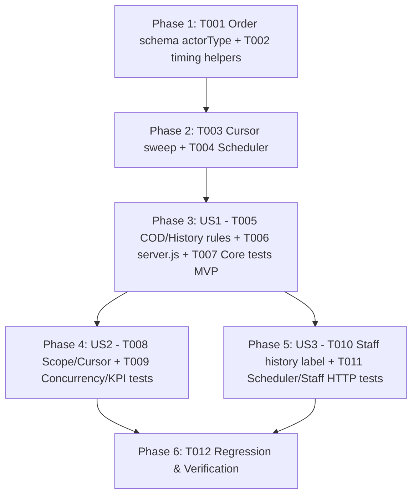

# Tasks: Tự Động Hoàn Thành Đơn Hàng Sau 3 Ngày Đang Giao (Auto Complete Shipping Orders)

**Input**: Design documents from `docs/specs/auto-complete-orders/` (`spec.md`, `plan.md`, `research.md`, `data-model.md`, `contracts/auto-complete-orders.md`, `quickstart.md`)

**Prerequisites**: `spec.md`, `plan.md`, `data-model.md`, `contracts/auto-complete-orders.md`

**Tests**: Bao gồm bộ kiểm thử unit & lifecycle Backend (`backend/tests/auto-complete-orders.test.js`) và kiểm thử hồi quy luồng trạng thái/xác nhận đơn hàng (`order-status.test.js`, `customer-order-receipt.test.js`, `orders.test.js`, `staff-analytics.test.js`).

**Organization**: Các tác vụ được tổ chức theo Setup, Foundational, 3 User Story độc lập (`US1`, `US2`, `US3`) và Verification.

## Format: `[ID] [P?] [Story?] Description with file path`

- **[P]**: Có thể thực hiện song song (khác tệp tin, không phụ thuộc tác vụ chưa hoàn tất)
- **[Story]**: Nhãn User Story tương ứng (`[US1]`, `[US2]`, `[US3]`)
- Mọi đường dẫn tệp tin được chỉ định chính xác theo cấu trúc kho mã nguồn.

---

## Phase 1: Setup (Schema Extension & Domain Timing Helpers)

**Purpose**: Mở rộng schema `statusHistory` an toàn ngược và tách logic thuần tính mốc 72 giờ giao hàng.

- [X] T001 Add optional `actorType: { type: String, enum: ["user", "system"] }` field on `statusHistorySchema` while keeping legacy records without `actorType` valid in `backend/src/models/order.model.js`
- [X] T002 [P] Create `backend/src/common/order-auto-complete.js` exporting `AUTO_COMPLETE_AFTER_MS = 3 * 24 * 60 * 60 * 1000`, `DEFAULT_SWEEP_INTERVAL_MS = 15 * 60 * 1000`, `DEFAULT_BATCH_SIZE = 100`, `resolveShippingStartedAt(order)` (searching backward in `order.statusHistory` for latest valid `to === "shipping"` timestamp with fallback to `order.updatedAt || order.createdAt`), and `isShippingOrderOverdue(order, now, thresholdMs)` (`channel === "online" && creationState !== "pending" && orderStatus === "shipping"` and `now - shippedAt >= thresholdMs`)

---

## Phase 2: Foundational (Batch Cursor Sweep & Non-Overlapping Scheduler)

**Purpose**: Triển khai hàm quét lô theo con trỏ `_id` có cập nhật nguyên tử và bộ lập lịch nền có cơ chế chống chạy chồng chéo.

**⚠️ CRITICAL**: Phải hoàn tất giai đoạn này trước khi gắn vào `server.js` và kiểm thử từng User Story.

- [X] T003 Implement `autoCompleteOverdueShippingOrders({ now, thresholdMs, batchSize } = {})` in `backend/src/common/order-auto-complete.js` using `_id > lastId` cursor pagination (`sort({ _id: 1 }).limit(batchSize)`) on `{ channel: "online", orderStatus: "shipping", creationState: { $ne: "pending" }, createdAt: { $lte: cutoff } }` and conditional atomic `Order.updateOne` (`{ runValidators: true }`), returning `{ checkedCount, completedCount, conflictCount }`
- [X] T004 Implement `startOrderAutoCompleteScheduler({ intervalMs, batchSize, onError } = {})` in `backend/src/common/order-auto-complete.js` enforcing an in-flight promise mutex, running an immediate initial sweep, scheduling `.unref()` interval ticks, and returning `{ runNow, stop }` where `stop()` clears the interval and awaits any active sweep

---

## Phase 3: User Story 1 - Hệ thống tự động hoàn thành đơn hàng quá 3 ngày kể từ lúc chuyển sang Đang giao (Priority: P1) 🎯 MVP

**Goal**: Tự động chuyển đơn `shipping` quá 72 giờ thành `completed`, cập nhật `paymentStatus: "paid"` cho đơn COD (`Q1: A`), ghi `statusHistory` hệ thống và tích hợp vòng đời khởi động/tắt của `server.js`.

**Independent Test**: Tạo đơn `COD` (`unpaid`) và đơn `ONLINE` (`paid`) đang `shipping` > 72 giờ cùng đơn mới 71 giờ và đơn `confirmed` > 5 ngày; chạy `autoCompleteOverdueShippingOrders` xác nhận chỉ 2 đơn quá 72 giờ chuyển `completed` + `COD` thành `paid` kèm lịch sử `{ from: "shipping", to: "completed", actorType: "system" }`.

### Implementation for User Story 1

- [X] T005 [US1] Ensure `autoCompleteOverdueShippingOrders` in `backend/src/common/order-auto-complete.js` filters atomically by `{ _id: order._id, channel: "online", orderStatus: "shipping", paymentStatus: order.paymentStatus, creationState: { $ne: "pending" } }`, sets `{ orderStatus: "completed", ...(order.paymentMethod === "COD" ? { paymentStatus: "paid" } : {}) }`, and pushes `{ from: "shipping", to: "completed", actorType: "system", at: now }`
- [X] T006 [US1] Wire `startOrderAutoCompleteScheduler` into `startServer()` after `createModelIndexes()` and `if (stopping)` guard, and await `scheduler?.stop()` before `disconnectDatabase()` inside `shutdown()` in `backend/src/server.js` (leaving `backend/src/app.js` completely free of background timers)
- [X] T007 [P] [US1] Create `backend/tests/auto-complete-orders.test.js` testing `72h` exact boundary (`71h59m` stays `shipping`, `72h` completes), `COD` `unpaid -> paid`, `ONLINE` stays `paid`, legacy `updatedAt`/`createdAt` fallback when `statusHistory` lacks `"shipping"`, and non-`shipping` (`pending`, `confirmed`, `processing`, `completed`, `cancelled`) exclusion

---

## Phase 4: User Story 2 - Phạm vi đơn hàng áp dụng và tính nhất quán sau khi tự động hoàn thành (Priority: P1)

**Goal**: Bảo đảm áp dụng cho mọi đơn online kể cả khách vãng lai (`Q2: A`), phân trang cursor chính xác qua nhiều lô dữ liệu và an toàn nguyên tử khi cạnh tranh với thao tác bấm nhận hàng của khách.

**Independent Test**: Kiểm tra lô có đơn khách vãng lai (`customerId: undefined`), đơn `needsReview: true`, danh sách hỗn hợp vượt quá `batchSize` (đơn tạo >3 ngày nhưng mới `shipping` 1 ngày xen lẫn đơn quá hạn), đơn `offline`, và tình huống `Order.updateOne` trả `modifiedCount: 0` do khách vừa bấm xác nhận.

### Implementation for User Story 2

- [X] T008 [P] [US2] Add test cases in `backend/tests/auto-complete-orders.test.js` verifying `Q2: A` coverage across authenticated customer orders, guest orders without `customerId`, `needsReview: true` orders, exclusion of `channel: "offline"` orders, and multi-batch `_id` cursor progression when `batchSize` is smaller than mixed-eligibility candidates
- [X] T009 [P] [US2] Add concurrency and cross-module compatibility tests in `backend/tests/auto-complete-orders.test.js` verifying atomic filter rejects stale sweep (`conflictCount: 1`, `completedCount: 0`) when customer receipt confirmation completes first, and ensuring system `statusHistory` entries include `to: "completed"` + valid `at` without setting `by` (preserving staff KPI isolation)

---

## Phase 5: User Story 3 - Ghi nhận lịch sử hệ thống rõ ràng và phục hồi khi gián đoạn (Priority: P2)

**Goal**: Hiển thị rõ tác nhân hệ thống trong lịch sử đơn hàng Staff (`"Hệ thống (tự động hoàn thành sau 3 ngày)"`), không phát sinh UI nhắc hạn hay `Notification` phía Customer (`Q3: B`), và bảo đảm scheduler chạy bù ngay khi khởi động lại sau downtime.

**Independent Test**: Bật scheduler với dữ liệu quá hạn sẵn có để xác nhận lượt quét bù chạy ngay, kiểm tra không lặp khi interval chồng lấn, kiểm tra `stop()` tắt timer sạch sẽ, và gọi `GET /api/v1/staff/orders/:id` xác nhận `actorName` trả `"Hệ thống (tự động hoàn thành sau 3 ngày)"`.

### Implementation for User Story 3

- [X] T010 [P] [US3] Update `statusHistory` actor resolution in `getStaffOrderDetail` (`backend/src/controllers/order.controller.js`) so entries without `h.by` and with `h.actorType === "system"` map `actorName` to `"Hệ thống (tự động hoàn thành sau 3 ngày)"` while leaving customer UI and `Notification` unchanged
- [X] T011 [P] [US3] Expand `backend/tests/auto-complete-orders.test.js` covering scheduler startup catch-up sweep, overlapping tick suppression via mutex, `onError` failure isolation without crashing, clean `stop()` timer cancellation, and HTTP assertion on `GET /api/v1/staff/orders/:id` returning `actorName: "Hệ thống (tự động hoàn thành sau 3 ngày)"`

---

## Phase 6: Polish & Cross-Cutting Verification

**Purpose**: Kiểm tra cú pháp, chạy đầy đủ test mới & test hồi quy liên quan và đối chiếu `quickstart.md`.

- [ ] T012 Run `node --check` on `backend/src/models/order.model.js`, `backend/src/common/order-auto-complete.js`, `backend/src/controllers/order.controller.js`, and `backend/src/server.js`, execute `npm.cmd --prefix backend test tests/auto-complete-orders.test.js tests/order-status.test.js tests/customer-order-receipt.test.js tests/orders.test.js tests/staff-analytics.test.js`, and validate end-to-end checklist in `docs/specs/auto-complete-orders/quickstart.md` *(Note: `node --check` and all 5 Vitest files `65/65` passed; live MongoDB runtime verification per `quickstart.md` remains for local server verification)*

---

## Dependencies & Execution Sequence

### User Story Dependencies & MVP Scope
- **Phase 1 → Phase 2**: Nền tảng bắt buộc trước khi ghép nối vòng đời `server.js`.
- **MVP Scope (Phase 1–3 / `US1`)**: Tự động hoàn thành đơn `shipping` quá 72 giờ (gồm `COD -> paid`) kèm chạy bù khi khởi động server.
- **US2 & US3 (Phase 4–5)**: Mở rộng kiểm chứng phạm vi khách vãng lai/cursor batch/tranh chấp đồng thời và nhãn lịch sử trên chi tiết đơn Staff (`T010` độc lập với `T008`–`T009`).

---

## Parallel Execution Opportunities

- **Phase 1**: `T001` (`order.model.js`) và `T002` (`order-auto-complete.js`) chạy song song.
- **Phase 4 & Phase 5**: `T010` (`order.controller.js`) chạy song song với `T007`/`T008`/`T009` (`auto-complete-orders.test.js`).

