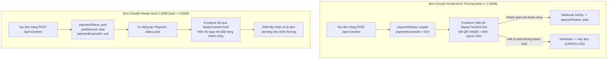

# Data Model & State Transitions: Bỏ Qua Chuyển Khoản Cho Đơn Dưới 1.000đ

**Feature**: `bypass-transfer-under-1000`  
**Date**: 2026-11-14  

---

## 1. Thực thể & Cấu trúc Dữ liệu (Entities)

### 1.1. Collection `orders` ([backend/src/models/order.model.js](../../../backend/src/models/order.model.js))

Không cần thay đổi schema MongoDB (tương thích 100% với schema hiện tại). Các trường trong document đơn hàng khi khởi tạo sẽ nhận giá trị như sau tùy theo `total`:

| Trường | Đơn bình thường (`total >= 1000`, `ONLINE`) | Đơn dưới 1.000đ (`total < 1000`, `ONLINE`) | Ghi chú |
| :--- | :--- | :--- | :--- |
| `orderCode` | Sinh tự động (`generateOrderCode()`) | Sinh tự động (`generateOrderCode()`) | Giữ nguyên format `PA...` |
| `paymentMethod` | `"ONLINE"` | `"ONLINE"` | Phương thức khách đã chọn |
| `paymentStatus` | `"unpaid"` (hoặc `"pending"`) | **`"paid"`** | **Được đánh dấu đã thanh toán ngay lập tức** |
| `orderStatus` | `"pending"` | `"pending"` | Chờ Staff duyệt & đóng gói giao hàng |
| `total` | Số tiền >= 1.000đ | Số tiền < 1.000đ (0đ, 500đ...) | Tính từ `subtotal - discount + shippingFee` |
| `paidAmount` | `0` | **`total`** | Ghi nhận đã thanh toán toàn bộ số tiền |
| `paymentExpiredAt` | `Date.now() + 15 phút` | **`undefined`** | **Không gán hạn chót thanh toán** |
| `needsReview` | `false` | `false` | Không đánh dấu nghi ngờ |
| `statusHistory` | `[{ to: "pending", at: now }]` | `[{ to: "pending", at: now, note: "Đơn hàng dưới 1.000đ tự động hoàn tất thanh toán" }]` | Lưu vết hệ thống |

---

### 1.2. Collection `payments` ([backend/src/models/payment.model.js](../../../backend/src/models/payment.model.js))

Khi đơn hàng `ONLINE` có `total < 1000` được tạo thành công, hệ thống tự động ghi nhận 1 bản ghi thanh toán để đảm bảo đối soát kế toán:

```javascript
{
  orderId: newOrder._id,
  method: "ONLINE",
  amount: total, // 0 hoặc < 1000
  status: "paid",
  transactionRef: `AUTO-PAID-${newOrder.orderCode}`,
  rawResult: {
    source: "system",
    reason: "BYPASS_TRANSFER_UNDER_1000",
    note: "Tự động hoàn tất thanh toán do giá trị đơn hàng nhỏ hơn 1.000đ",
    autoCompletedAt: new Date()
  }
}
```

---

## 2. Máy Trạng thái & Vòng đời Đơn hàng (State Machine)

### 2.1. So sánh Vòng đời Đơn hàng



---

## 3. Quy tắc Xác thực & Ràng buộc Dữ liệu (Validation Rules)

1. **Điều kiện kích hoạt**:
   - `order.channel === "online"`
   - `order.paymentMethod === "ONLINE"`
   - `order.total < 1000` (bao gồm `total === 0`)
2. **Quy tắc tính tiền**:
   - `order.total` là số nguyên không âm (`>= 0`).
   - Nếu `order.total < 0` (do lỗi logic voucher), hệ thống chặn tại schema validator `nonNegativeInteger`.
3. **Quy tắc thanh toán**:
   - `order.paidAmount === order.total`.
   - `order.paymentExpiredAt === undefined`.
4. **Quy tắc thanh toán lại (Resume Payment)**:
   - Vì `order.paymentStatus === "paid"`, các API `/api/v1/payments/sepay/info/:orderCode` hoặc `/api/v1/orders/:id/payment` đều nhận diện là đơn đã thanh toán xong, trả về `isPaid: true` và `remainingAmount: 0`.
