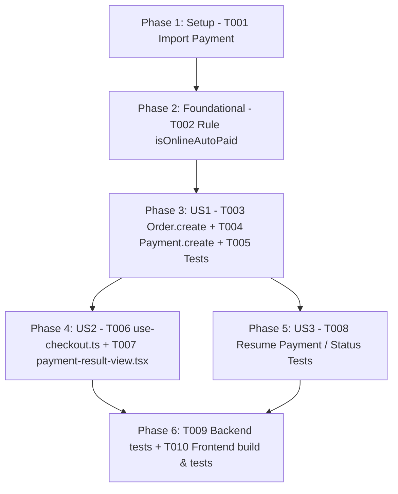

# Tasks: Tự Động Bỏ Qua Chuyển Khoản Cho Đơn Dưới 1.000đ (Bypass Transfer Under 1000)

**Input**: Design documents from `docs/specs/bypass-transfer-under-1000/` (`spec.md`, `plan.md`, `research.md`, `data-model.md`, `contracts/bypass-transfer-api.yaml`, `quickstart.md`)  
**Prerequisites**: `spec.md`, `plan.md`, `data-model.md`, `contracts/bypass-transfer-api.yaml`  
**Tests**: Unit tests in `backend/tests/orders.test.js`, full backend test suite (`npm --prefix backend test`), frontend unit tests and production build (`npm --prefix frontend test`, `npm --prefix frontend run build`).  
**Organization**: Setup, Foundational, 3 User Story phases (`US1`, `US2`, `US3`), and Polish/Verification.

## Format: `- [ ] [TaskID] [P?] [Story?] Description with file path`

- **[P]**: Parallelizable (different files, no blocking incomplete dependencies)
- **[Story]**: User story label (`[US1]`, `[US2]`, `[US3]`)
- Every task includes an explicit, unambiguous file path.

---

## Phase 1: Setup

**Purpose**: Chuẩn bị các dependency model phục vụ việc ghi nhận thanh toán tự động trong controller đơn hàng.

- [X] T001 Import `Payment` model from `../models/payment.model.js` in `backend/src/controllers/order.controller.js`

---

## Phase 2: Foundational

**Purpose**: Thiết lập điều kiện nhận diện và hằng số đơn hàng trực tuyến dưới 1.000đ (`total < 1000 && paymentMethod === "ONLINE"`).

**⚠️ CRITICAL**: Phải hoàn thành giai đoạn này trước khi triển khai các User Story chi tiết.

- [X] T002 Define auto-paid evaluation rule `const isOnlineAutoPaid = paymentMethod === "ONLINE" && total < 1000;` within `createOrder` in `backend/src/controllers/order.controller.js`

---

## Phase 3: User Story 1 - Tự động hoàn tất thanh toán và tạo bản ghi Payment ở Backend (Priority: P1) 🎯 MVP

**Goal**: Đơn hàng trực tuyến dưới 1.000 VNĐ (`total < 1000`) khi chọn phương thức `ONLINE` sẽ tự động được gán `paymentStatus: "paid"`, `paidAmount: total`, `paymentExpiredAt: undefined`, ghi chú `statusHistory`, và tự động lưu 1 bản ghi `Payment` với trạng thái `"paid"`.

**Independent Test**: Gửi request `POST /api/v1/orders` với `paymentMethod: "ONLINE"` và các sản phẩm / voucher dẫn đến `total < 1000` (ví dụ `total === 0` hoặc `total === 500`). Xác nhận đơn hàng lưu vào database có `paymentStatus === "paid"`, `paidAmount === total`, `paymentExpiredAt` không có giá trị, và xuất hiện 1 bản ghi trong collection `payments` có `status === "paid"`.

### Implementation for User Story 1

- [X] T003 [US1] Update `Order.create` parameters in `createOrder` in `backend/src/controllers/order.controller.js` so that when `isOnlineAutoPaid` is true: set `paymentStatus: "paid"`, `paidAmount: total`, omit `paymentExpiredAt`, and append note `"Đơn hàng dưới 1.000đ tự động hoàn tất thanh toán"` into the initial `statusHistory` entry
- [X] T004 [US1] Create automated `Payment` record via `Payment.create({ orderId: newOrder._id, method: "ONLINE", amount: total, status: "paid", transactionRef: "AUTO-PAID-" + newOrder.orderCode, rawResult: { source: "system", reason: "BYPASS_TRANSFER_UNDER_1000", note: "Tự động hoàn tất thanh toán do giá trị đơn hàng nhỏ hơn 1.000đ", autoCompletedAt: new Date() } })` inside `createOrder` in `backend/src/controllers/order.controller.js`
- [X] T005 [P] [US1] Add unit tests in `backend/tests/orders.test.js` verifying that `POST /api/v1/orders` with `paymentMethod === "ONLINE"` and `total < 1000` creates order with `paymentStatus: "paid"`, `paidAmount: total`, and invokes `Payment.create`, while orders with `total >= 1000` retain `paymentStatus: "unpaid"` and `paidAmount: 0`

---

## Phase 4: User Story 2 - Bỏ qua giao diện quét mã VietQR và hiển thị kết quả đặt hàng thành công trên Frontend (Priority: P1)

**Goal**: Trình duyệt khi chuyển hướng sang `/checkout/result` với đơn hàng dưới 1.000 VNĐ sẽ bỏ qua hoàn toàn component `SepayTransferCard` (mã QR VietQR và đồng hồ đếm ngược 15 phút) và hiển thị ngay màn hình "Đặt hàng thành công / Thanh toán thành công".

**Independent Test**: Mở `/checkout/result?orderCode=PA261114001&total=500&paymentMethod=ONLINE&paymentProvider=sepay&isPaid=true`. Xác nhận component `SepayTransferCard` không xuất hiện, thẻ xanh thông báo thành công hiển thị ngay lập tức với đầy đủ thông tin đơn hàng và phương thức thanh toán.

### Implementation for User Story 2

- [X] T006 [P] [US2] Update `handlePlaceOrder` in `frontend/features/checkout/hooks/use-checkout.ts` to include `isPaid: String(order?.paymentStatus === "paid")` in query parameters when navigating via `router.push('/checkout/result?...')`
- [X] T007 [P] [US2] Update `PaymentResultView` in `frontend/features/checkout/components/payment-result-view.tsx` to read `isPaid` from `searchParams` (`const [isPaid, setIsPaid] = useState(searchParams.get("isPaid") === "true" || total < 1000)`) and enforce `total >= 1000` in `isSepayPending` so `SepayTransferCard` is completely skipped when `total < 1000`

---

## Phase 5: User Story 3 - Bảo đảm tính nhất quán khi kiểm tra trạng thái và thanh toán lại (Priority: P2)

**Goal**: Ngăn chặn người dùng bấm "Thanh toán lại" hoặc kích hoạt lại phiên thanh toán QR đối với đơn hàng dưới 1.000 VNĐ đã được tự động thanh toán.

**Independent Test**: Gọi API gia hạn hoặc truy vấn thông tin thanh toán (`/api/v1/payments/status/:orderCode` hoặc `POST /api/v1/orders/:id/payment/renew`) với đơn hàng dưới 1.000 VNĐ đã `paid`. Xác nhận API trả về `isPaid: true` và chặn gia hạn phiên với mã lỗi `ORDER_ALREADY_PAID` (409/400).

### Implementation for User Story 3

- [X] T008 [P] [US3] Add test case in `backend/tests/orders.test.js` or `backend/tests/sepay-payment.test.js` verifying that orders auto-paid under 1.000đ cannot have payment renewed or resumed via `getOnlinePaymentIneligibilityError`, confirming `isPaid: true` and rejection with `ORDER_ALREADY_PAID`

---

## Phase 6: Polish & Cross-Cutting Verification

**Purpose**: Xác thực toàn bộ hệ thống qua unit tests, linting, và build kiểm tra kiểu dữ liệu TypeScript.

- [X] T009 Run backend test suite via `npm --prefix backend test` and ensure all test suites pass without regression
- [X] T010 [P] Run frontend test suite and production build via `npm --prefix frontend test` and `npm --prefix frontend run build` to confirm zero lint/type errors and zero bundle breakages

---

## Dependencies & Execution Sequence

### User Story Dependencies & MVP Scope
- **Phase 1 & Phase 2**: Điều kiện tiên quyết của Backend.
- **Phase 3 (User Story 1)**: 🎯 **MVP** - Đảm bảo dữ liệu đơn hàng và thanh toán trên MongoDB chính xác tuyệt đối ngay tại điểm tạo đơn.
- **Phase 4 (User Story 2)**: Trải nghiệm người dùng storefront - Khách hàng không bị bắt quét QR khi đơn < 1.000đ.
- **Phase 5 (User Story 3)**: Bảo vệ luồng phụ (xem lại đơn hàng, tránh gọi gia hạn QR không cần thiết).
- **Phase 6**: Nghiệm thu và kiểm thử hồi quy toàn bộ hệ thống.
