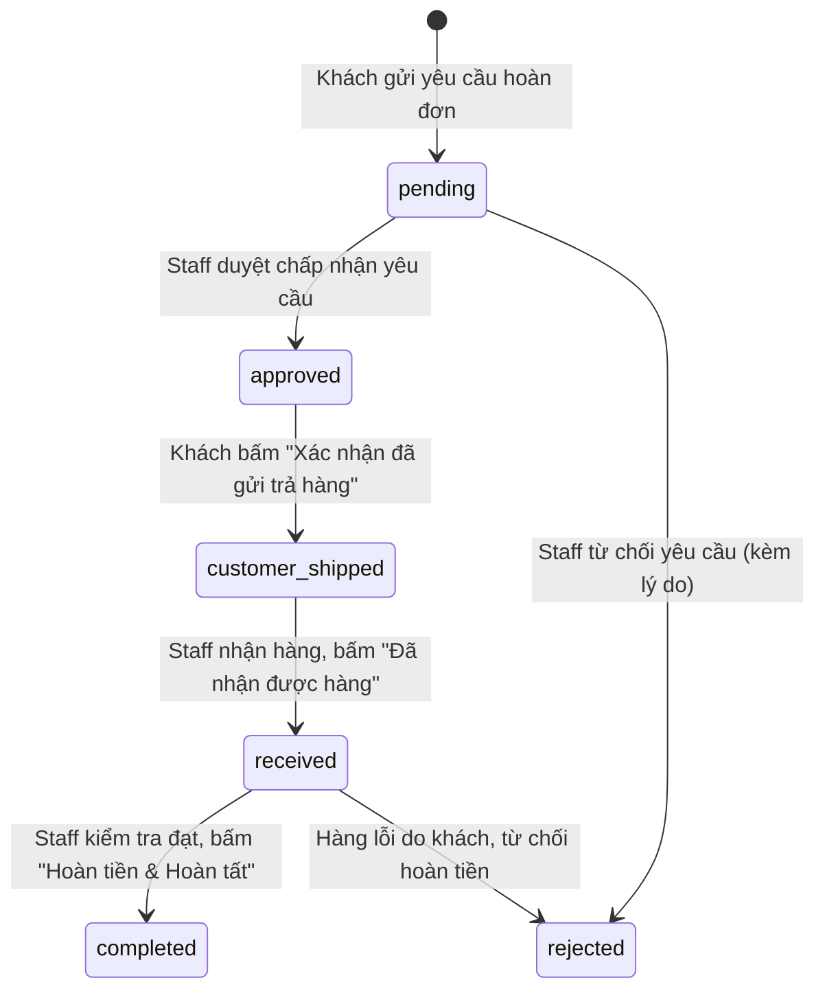

# Data Model: Quy Trình Hoàn Trả Đơn Hàng Nhiều Bước & UI Timeline (Order Returns Workflow)

## Lưu từng lần gửi

`returnRequests` là nguồn dữ liệu chính, mỗi document mang `_id` riêng, `orderId`, nội dung và các mốc xử lý của một lần gửi. `cancelled` có `cancelledAt`. Index duy nhất có điều kiện áp dụng cho `pending`, `approved`, `customer_shipped` và `received` trên mỗi `orderId`.

`orders.latestReturn` lưu `requestId`, `status` và `reviewedAt` nếu có. `orders.returnWindowCompletedAt` giữ mốc hoàn thành đã dùng để tính hạn hoàn với đơn cũ. Trường nhúng `returnRequest` được giữ trong thời gian chuyển dữ liệu.

`orders.returnOperation` giữ thao tác đang thực hiện. Backend cập nhật có điều kiện trên đơn để chỉ tiếp nhận một thao tác tại một thời điểm. `returnRequests.lastOperationId`, mã nhật ký và `products.returnRestockKeys` cho phép chạy lại các bước ghi. Mã hoàn kho được lưu cùng lần tăng tồn của từng SKU. Backend cập nhật `latestReturn` và xóa thao tác sau khi các bước ghi hoàn tất.

**Feature Directory**: `docs/specs/order-returns` | **Date**: 2026-11-13

---

## 1. Mở rộng Enum & Schema trên `Order`

### 1.1. `orderStatuses` (`backend/src/models/shared.schema.js`)
Trạng thái đơn hàng:
```text
["pending", "confirmed", "processing", "shipping", "completed", "cancelled", "returned"]
```

### 1.2. Mở rộng `returnStatuses` & Schema `returnRequestSchema` (`backend/src/models/order.model.js`)

Mở rộng danh sách trạng thái của yêu cầu hoàn trả:
```js
const returnStatuses = [
  "pending",           // Chờ nhân viên xét duyệt yêu cầu ban đầu
  "approved",          // Nhân viên chấp nhận yêu cầu, chờ khách gửi hàng
  "customer_shipped",  // Khách hàng đã bấm "Xác nhận đã gửi trả hàng"
  "received",          // Cửa hàng đã nhận được kiện hàng, nhân viên đang kiểm tra
  "completed",         // Nhân viên kiểm tra đạt yêu cầu, xác nhận hoàn tiền & hoàn tất
  "rejected",          // Bị từ chối (ở bước duyệt yêu cầu hoặc bước kiểm tra hàng)
  "cancelled",         // Khách đã hủy trước khi gửi hàng
];
```

#### Chi tiết các trường trong `returnRequestSchema`:

| Trường | Kiểu & Ràng buộc | Mô tả |
|---|---|---|
| `reason` | `String`, enum `["damaged_or_defective", "not_received", "missing_items", "damaged_or_missing"]`, required | Lý do hoàn trả. Form khách hàng chọn 1 trong 2: **Hàng có vấn đề hoặc thiếu hàng** (`damaged_or_missing`) và **Chưa nhận được hàng** (`not_received`). |
| `bankAccount` | `Object`, required | Thông tin tài khoản ngân hàng của khách để chuyển tiền hoàn |
| `bankAccount.bankName` | `String`, required, trim, minlength `2`, maxlength `100` | Tên ngân hàng nhận tiền |
| `bankAccount.accountNumber` | `String`, required, trim, minlength `6`, maxlength `30` | Số tài khoản ngân hàng |
| `bankAccount.accountHolder` | `String`, required, trim, minlength `2`, maxlength `100` | Tên chủ tài khoản ngân hàng (in hoa) |
| `description` | `String`, required, trim, minlength `10`, maxlength `1000` | Mô tả chi tiết vấn đề gặp phải |
| `images` | `[String]`, maxlength `5` items, URL Cloudinary | Danh sách hình ảnh minh chứng |
| `status` | `String`, enum `returnStatuses`, required | Trạng thái hiện tại trong chu trình hoàn trả |
| `refundRequired` | `Boolean`, default `false` | Đánh dấu đơn cần chuyển khoản hoàn tiền |
| `refundStatus` | `String`, enum `["none", "pending_refund", "refunded"]`, default `"none"` | Tình trạng đối soát hoàn tiền |
| `requestedBy` | `ObjectId` (`ref: "User"`), required | Khách hàng tạo yêu cầu |
| `requestedAt` | `Date`, required | Thời điểm khách gửi yêu cầu |
| `approvedAt` | `Date` | Thời điểm Staff duyệt chấp nhận yêu cầu |
| `customerShippedAt` | `Date` | Thời điểm khách bấm xác nhận đã gửi trả hàng |
| `receivedAt` | `Date` | Thời điểm Staff bấm đã nhận được hàng |
| `completedAt` | `Date` | Thời điểm Staff hoàn tất kiểm tra và duyệt hoàn tiền |
| `refundAmount` | `Number` | Số tiền hoàn thực tế cho khách (mặc định bằng tổng tiền đơn hàng, nhân viên có quyền điều chỉnh) |
| `reviewedBy` | `ObjectId` (`ref: "User"`) | Nhân viên phụ trách xử lý |
| `reviewedAt` | `Date` | Thời điểm nhân viên xử lý quyết định cuối |
| `rejectionReason` | `String`, trim, maxlength `500` | Lý do từ chối (nếu bị từ chối) |

---

## 2. Máy trạng thái 4 Giai đoạn & Chuyển đổi nguyên tử



### Các điều kiện chuyển đổi chi tiết:

1. **Khách gửi yêu cầu**:
   - Điều kiện: Đơn đang `shipping`, chưa có `returnRequest.status`.
   - Cập nhật: `returnRequest.status = "pending"`, `requestedAt = now`.

2. **Staff duyệt yêu cầu (Cấp 1)**:
   - Điều kiện: `returnRequest.status === "pending"`.
   - Chấp nhận: `returnRequest.status = "approved"`, `approvedAt = now`, `reviewedBy = staffId`.
   - Từ chối: `returnRequest.status = "rejected"`, `rejectionReason = ...`, `reviewedAt = now`. Mở lại nút nhận hàng cho khách.

3. **Khách xác nhận đã gửi hàng (Cấp 2)**:
   - Điều kiện: `returnRequest.status === "approved"`.
   - Cập nhật: `returnRequest.status = "customer_shipped"`, `customerShippedAt = now`.

4. **Staff xác nhận đã nhận hàng (Cấp 3)**:
   - Điều kiện: `returnRequest.status === "customer_shipped"`.
   - Cập nhật: `returnRequest.status = "received"`, `receivedAt = now`.

5. **Staff quyết định hoàn tiền & Hoàn tất (Cấp 4)**:
   - Điều kiện: `returnRequest.status === "received"`.
   - Chấp nhận hoàn tiền:
     - `orderStatus = "returned"`
     - `returnRequest.status = "completed"`, `completedAt = now`
     - `refundStatus = (refundRequired ? "refunded" : "none")`
     - **Hoàn tồn kho**: `Product.variants.$.stock += item.qty`
     - Ghi AuditLog `order.return.complete`
   - Từ chối hoàn tiền:
     - `returnRequest.status = "rejected"`, `rejectionReason = ...`

---

## 3. Order Timeline Data Model (UI Tracking & Detail)

Khi đơn hàng có `returnRequest`, API trả về 4 bước timeline:

```json
[
  {
    "id": "step-return-request",
    "title": "Yêu cầu hoàn đơn",
    "description": "23:54 · 12/11/2026",
    "status": "completed"
  },
  {
    "id": "step-return-approve",
    "title": "Chờ xác nhận",
    "description": "Nhân viên xác nhận & gửi hàng",
    "status": "completed"
  },
  {
    "id": "step-return-inspect",
    "title": "Nhân viên kiểm tra",
    "description": "Kiểm tra tình trạng hàng hoàn",
    "status": "active"
  },
  {
    "id": "step-return-complete",
    "title": "Hoàn thành công",
    "description": "Hoàn tiền & hoàn tất",
    "status": "pending"
  }
]
```
