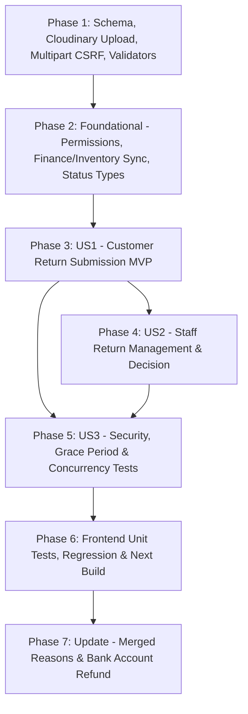

# Tasks: Yêu Cầu Hoàn Trả Đơn Hàng & Duyệt Hoàn Đơn (Order Returns)

**Input**: Design documents from `docs/specs/order-returns/` (`spec.md`, `plan.md`, `research.md`, `data-model.md`, `contracts/order-returns-api.yaml`, `quickstart.md`)

**Prerequisites**: `spec.md`, `plan.md`, `data-model.md`, `contracts/order-returns-api.yaml`

**Tests**: Bao gồm bộ kiểm thử Backend (`backend/tests/order-returns.test.js`, hồi quy `admin-permissions.test.js`, `order-status.test.js`, `customer-order-receipt.test.js`, `auto-complete-orders.test.js`, `orders.test.js`, `admin-finance.test.js`) và Frontend (`frontend/tests/order-returns.test.mjs`, cập nhật `staff-orders.test.mjs`).

**Organization**: Các tác vụ được chia theo Setup, Foundational, 3 User Story độc lập (`US1`, `US2`, `US3`) và Polish/Verification.

## Format: `[ID] [P?] [Story?] Description with file path`

- **[P]**: Có thể thực hiện song song (khác tệp tin, không phụ thuộc tác vụ chưa hoàn tất)
- **[Story]**: Nhãn User Story tương ứng (`[US1]`, `[US2]`, `[US3]`)
- Mọi đường dẫn tệp tin được chỉ định chính xác theo cấu trúc kho mã nguồn.

---

## Phase 1: Setup (Schema, Cloudinary Upload, Multipart CSRF & Validators)

**Purpose**: Chuẩn bị schema `returnRequest` và trạng thái `"returned"` trên `Order`, dịch vụ upload Cloudinary an toàn, bảo vệ CSRF cho multipart và bộ validator Zod.

- [X] T001 Add `"returned"` to `orderStatuses` in `backend/src/models/shared.schema.js`, and add `returnRequestSchema` (`reason: ["damaged_or_defective", "not_received", "missing_items"]`, `description` required trimmed `10..1000` chars, `images` max `5` `https://res.cloudinary.com/...` URLs, `status: ["pending", "approved", "rejected"]`, `refundRequired` boolean default `false`, `refundStatus: ["none", "pending_refund", "refunded"]` default `"none"`, `requestedBy`, `requestedAt`, `reviewedBy`, `reviewedAt`, `rejectionReason` trimmed maxlength `500`) plus compound index `{ "returnRequest.status": 1, "returnRequest.requestedAt": -1 }` in `backend/src/models/order.model.js`
- [X] T002 [P] Create shared Cloudinary image uploader helper `backend/src/common/cloudinary-upload.js` exporting `ALLOWED_RETURN_IMAGE_MIME_TYPES = ["image/jpeg", "image/jpg", "image/png", "image/webp"]` and `uploadImageBuffersToCloudinary(files, { folder = "petjoy/returns", maxFiles = 5 })` using `configureCloudinary()` and `cloudinary.uploader.upload_stream`
- [X] T003 [P] Extract reusable Origin/CSRF verification inside `backend/src/controllers/auth.controller.js` and export `protectMultipartMutation` validating `CORS_ORIGIN`, `multipart/form-data`, and matching `X-CSRF-Token` / cookie pair before Multer upload processing
- [X] T004 [P] Create `backend/src/validators/order-return.validator.js` defining `customerReturnRequestSchema` (`reason` enum, `description` `10..1000`, `images` `0..5` `https://res.cloudinary.com/...` URLs requiring `>= 1` image when `reason !== "not_received"` per `Q1: A`), `staffReturnQuerySchema` (`status: ["all", "pending", "approved", "rejected"]`, `query`, `page`, `pageSize`), and `staffReturnDecisionSchema` (`decision: ["approve", "reject"]`, requiring `rejectionReason` `5..500` chars when `decision === "reject"`)

---

## Phase 2: Foundational (Validators, Permissions, Finance/Inventory Sync & Status Mappings)

**Purpose**: Đồng bộ trạng thái `"returned"` và ma trận quyền Staff trên Backend/Frontend trước khi xây dựng các luồng giao diện người dùng.

**⚠️ CRITICAL**: Hoàn tất giai đoạn này trước khi ghép nối màn hình Customer (`US1`) và Staff (`US2`).

- [X] T005 Update `staffOrderStatuses` (include `"returned"`) and `staffOrderTransitions` (`returned: []`, keeping `staffOrderStatusSchema` limited to `["confirmed", "processing", "shipping", "cancelled"]`) in `backend/src/validators/order.validator.js`, and include `"returned"` in `status` filter of `backend/src/validators/admin/order.validator.js`
- [X] T006 [P] Register `"GET /staff/returns"`, `"GET /staff/returns/:id"`, and `"POST /staff/returns/:id/decision"` under `"process-orders"` in `PERMISSIONS` (`backend/src/common/permissions.js`) so `backend/tests/admin-permissions.test.js` passes
- [X] T007 [P] Synchronize `"returned"` across downstream backend modules: block `"returned"` in `canResumeOnlinePayment` & `getOnlinePaymentIneligibilityError` (`backend/src/common/order-payment.js`), exclude `"returned"` from revenue and include `{ $in: ["cancelled", "returned"] }` paid orders in `refunds` (`backend/src/controllers/admin-finance.controller.js`), exclude `"returned"` in `backend/src/controllers/admin-inventory-report.controller.js`, and accept `"returned"` in `backend/src/controllers/admin/order.controller.js`
- [X] T008 [P] Add `"returned"` (`"Đã hoàn trả"`) to `OrderStatus`, `orderStatusLabels`, `orderStatusTones`, and optional `returned?` count in `frontend/features/staff/orders/types.ts`, `frontend/features/staff/components/orders-list.tsx`, `frontend/features/admin/types.ts`, and `frontend/features/admin/status.ts`, and update `frontend/tests/staff-orders.test.mjs` to cover all 7 statuses

**Checkpoint**: Nền tảng schema, quyền, bảo mật upload và báo cáo đồng bộ sẵn sàng cho `US1` và `US2`.

---

## Phase 3: User Story 1 - Khách hàng gửi yêu cầu hoàn trả hàng kèm lý do, mô tả và hình ảnh minh chứng (Priority: P1) 🎯 MVP

**Goal**: Từ Chi tiết đơn hàng đang `shipping`, khách hàng bấm **"Hoàn trả hàng"** -> mở `/orders/[id]/return`, chọn lý do, nhập mô tả, tải ảnh lên Cloudinary (bắt buộc với *"Hàng có vấn đề"* / *"Thiếu hàng"*, tùy chọn với *"Chưa nhận được hàng"*), gửi yêu cầu sang trạng thái `"pending"` và tạm khóa nút **"Đã nhận được hàng"** + tự động hoàn thành 3 ngày.

**Independent Test**: Đăng nhập Customer sở hữu đơn `shipping`, bấm **"Hoàn trả hàng"** tại `/orders/<id>`, kiểm tra chặn thiếu ảnh khi chọn `damaged_or_defective`, upload ảnh hợp lệ lên Cloudinary, gửi yêu cầu thành công về `/orders/<id>` hiển thị thẻ `"Đang chờ xử lý hoàn trả"` và ẩn nút **"Đã nhận được hàng"**.

### Implementation for User Story 1

- [X] T009 [US1] Implement `uploadCustomerReturnImages` and `submitCustomerReturnRequest` (atomic `Order.updateOne` filtering `{ _id, customerId, channel: "online", orderStatus: "shipping", creationState: { $ne: "pending" }, "returnRequest.status": { $exists: false } }`, `Cache-Control: no-store`) in `backend/src/controllers/order-return.controller.js`, and mount `POST /:id/return/upload` (with Multer `memoryStorage` `<=5MB`, max 5 files, MIME allowlist error handling) and `POST /:id/return` with `noStore, requireAuth, requireRole("customer"), protectMultipartMutation/protectMutation` in `backend/src/routers/order.router.js`
- [X] T010 [US1] Expose `returnRequest`, `canRequestReturn`, and `canConfirmReceipt` in `getOrderDetail` (`backend/src/controllers/order.controller.js`), guard `confirmCustomerOrderReceipt` (`backend/src/controllers/order-status.controller.js`) with `"returnRequest.status": { $nin: ["pending", "approved"] }`, and update `autoCompleteOverdueShippingOrders` + `isShippingOrderOverdue` (`backend/src/common/order-auto-complete.js`) to skip orders where `returnRequest.status` is `"pending"` or `"approved"`
- [X] T011 [P] [US1] Extend `frontend/features/orders/types.ts` with `ReturnRequestReason`, `ReturnRequestStatus`, `CustomerOrderReturnRequest`, `canRequestReturn?`, `canConfirmReceipt?`, `returnRequest?`, and create `frontend/features/orders/services/order-return.service.ts` implementing CSRF-protected `uploadReturnImagesApi(orderId, files)` (`multipart/form-data`, `X-CSRF-Token`, `credentials: "include"`, `cache: "no-store"`) and `submitOrderReturnApi(orderId, payload)`
- [X] T012 [P] [US1] Create `useOrderReturn(orderId)` hook (`frontend/features/orders/hooks/use-order-return.ts`) validating reason, description (`10..1000`), and `isReturnImageRequired(reason)` (`>=1` image for `damaged_or_defective` / `missing_items`, optional `0..5` for `not_received`), and create `OrderReturnView` (`frontend/features/orders/components/order-return-view.tsx`) exported from `frontend/features/orders/index.tsx`
- [X] T013 [US1] Create Customer route `frontend/app/(customer)/orders/[id]/return/page.tsx` wrapped in `<Suspense>`, and update `OrderSummarySidebar` (`frontend/features/orders/components/order-summary-sidebar.tsx`) to render **"Hoàn trả hàng"** link (`/orders/${order.id}/return`) beside **"Đã nhận được hàng"** when `canRequestReturn` is true and hide **"Đã nhận được hàng"** while showing the `"Chờ xử lý hoàn trả"` summary card when `returnRequest.status === "pending"`

**Checkpoint**: User Story 1 (MVP) hoàn thành — Khách hàng gửi được yêu cầu hoàn trả kèm ảnh Cloudinary và khóa xung đột nhận hàng / auto-complete.

---

## Phase 4: User Story 2 - Nhân viên (Staff) quản lý, xem chi tiết và phê duyệt hoặc từ chối yêu cầu hoàn trả (Priority: P1)

**Goal**: Staff có màn hình `/staff/returns` quản lý/lọc các yêu cầu hoàn trả, mở `/staff/returns/[id]` xem đầy đủ thông tin + phóng to ảnh Cloudinary, và thực hiện **Chấp nhận hoàn trả** (đơn thành `"Đã hoàn trả"`, hoàn tồn kho, đánh dấu `Cần hoàn tiền` với đơn `ONLINE paid`) hoặc **Từ chối hoàn trả** (nhập lý do bắt buộc 5–500 ký tự, hiển thị lại cho khách mà không cho gửi lại theo `Q3: A`).

**Independent Test**: Đăng nhập Staff, vào `/staff/returns` lọc `"Chờ xử lý"`, mở chi tiết xem ảnh minh chứng; chấp nhận đơn A xác nhận `orderStatus: "returned"` + `stock` được cộng lại + flag `refundRequired`; từ chối đơn B kèm lý do xác nhận khách xem được lý do và bấm lại được `"Đã nhận được hàng"` nhưng không gửi lại được đơn hoàn.

### Implementation for User Story 2

- [X] T014 [US2] Implement `listStaffReturns`, `getStaffReturnDetail`, and `decideStaffReturn` in `backend/src/controllers/order-return.controller.js` (atomic `Order.updateOne` filtering `{ _id: id, channel: "online", orderStatus: "shipping", "returnRequest.status": "pending" }`; on `approve`: setting `orderStatus: "returned"`, `returnRequest.status: "approved"`, `refundRequired: order.paymentMethod === "ONLINE" && order.paymentStatus === "paid"`, `refundStatus`, pushing `statusHistory { from: "shipping", to: "returned", by: staffId, at }`, restoring `Product.variants.$.stock` += `item.qty` only when `modifiedCount === 1`, and recording `AuditLog` `order.return.approve`; on `reject`: setting `returnRequest.status: "rejected"`, `rejectionReason`, and recording `AuditLog` `order.return.reject`), and mount routes in `backend/src/routers/workspace.router.js`
- [X] T015 [P] [US2] Create `frontend/features/staff/returns/types.ts` and `frontend/features/staff/returns/api.ts` (`fetchStaffReturns`, `fetchStaffReturnDetail`, `submitStaffReturnDecision` with CSRF & `no-store`) and add **"Yêu cầu hoàn trả"** (`/staff/returns`) navigation entry in `frontend/features/staff/components/staff-shell.tsx`
- [X] T016 [P] [US2] Create `ReturnsList` (`frontend/features/staff/components/returns-list.tsx`) with status filter tabs (`Tất cả`, `Chờ xử lý`, `Đã chấp nhận`, `Đã từ chối`), search input, photo count & `Cần hoàn tiền` indicator, and create SSR route `frontend/app/(workspace)/staff/returns/page.tsx` (`401 -> /login`, `403 -> /forbidden`)
- [X] T017 [P] [US2] Create `ReturnDecisionPanel` (`frontend/features/staff/components/return-decision-panel.tsx`) displaying reason, description, Cloudinary photo gallery with zoom modal, order items/totals & `ONLINE` refund notice, inline confirmation for **"Chấp nhận hoàn trả"**, required `rejectionReason` (`5..500` chars) for **"Từ chối hoàn trả"**, and create SSR route `frontend/app/(workspace)/staff/returns/[id]/page.tsx`
- [X] T018 [US2] Update `OrderSummarySidebar` (`frontend/features/orders/components/order-summary-sidebar.tsx`) to display `"Đã hoàn trả"` / `"Cần hoàn tiền"` when `approved` and display rejection badge + `rejectionReason` when `rejected` while keeping **"Đã nhận được hàng"** enabled and **"Hoàn trả hàng"** permanently disabled (`Q3: A`)

**Checkpoint**: User Story 2 hoàn thành — Quy trình duyệt/từ chối hoàn trả giữa Customer và Staff vận hành khép kín.

---

## Phase 5: User Story 3 - Kiểm soát an toàn tệp ảnh, phân quyền và tính nhất quán dữ liệu hoàn trả (Priority: P2)

**Goal**: Bảo đảm an toàn upload ảnh, phân quyền tuyệt đối, chống xử lý trùng lặp và đồng bộ 24h đệm tự động hoàn thành sau khi hoàn trả bị từ chối.

**Independent Test**: Gửi tệp sai định dạng / >5MB / >5 ảnh lên `/upload`, thử duyệt 1 yêu cầu bằng 2 request đồng thời, kiểm tra phân quyền `401`/`403`/`404` và kiểm tra quy tắc auto-complete với `pending` / `approved` / `rejected`.

### Implementation for User Story 3

- [X] T019 [P] [US3] Enforce 24-hour post-rejection grace period (`max(shippedAt + 72h, reviewedAt + 24h)`) in `backend/src/common/order-auto-complete.js`, and ensure `POST /orders/:id/return/upload` validates ownership/eligibility (`shipping`, no existing `returnRequest`) plus file allowlist (`JPG`/`PNG`/`WEBP`, `<=5MB`, `1..5` files) BEFORE invoking Cloudinary upload
- [X] T020 [P] [US3] Create comprehensive Backend unit & HTTP test suite `backend/tests/order-returns.test.js` covering upload MIME/size/max-5/CSRF/ownership errors, submit image rules (`Q1: A`), `409` duplicate return lock, Staff `approve` (status `returned`, stock restoration, `ONLINE` `refundRequired`, `COD` no refund flag, `AuditLog`), Staff `reject` (reason validation `5..500`), concurrent Staff approval race (`only 1 stock increment`), `confirmCustomerOrderReceipt` lock/unlock, `autoCompleteOverdueShippingOrders` skip + 24h grace after rejection, and `401`/`403`/`404` authorization guards

**Checkpoint**: User Story 3 hoàn thành — Bảo mật upload, phân quyền và đồng bộ cạnh tranh được kiểm chứng tự động.

---

## Phase 6: Polish & Cross-Cutting Verification

**Purpose**: Kiểm thử lớp Client Frontend, chạy toàn bộ bộ test hồi quy Backend/Frontend, ESLint và Next.js production build.

- [X] T021 [P] Create Frontend unit tests in `frontend/tests/order-returns.test.mjs` covering `isReturnImageRequired`, client return validation, `uploadReturnImagesApi` (`multipart/form-data`, `X-CSRF-Token`, `credentials: "include"`), `submitOrderReturnApi`, and `submitStaffReturnDecision` (`CSRF`, error code mapping, malformed response rejection)
- [X] T022 Run `node --check` on changed backend JS files, execute Backend tests (`npm.cmd --prefix backend test tests/order-returns.test.js tests/admin-permissions.test.js tests/order-status.test.js tests/customer-order-receipt.test.js tests/auto-complete-orders.test.js tests/orders.test.js tests/admin-finance.test.js`), Frontend unit tests (`npm.cmd --prefix frontend test`), targeted ESLint on all modified/created frontend files, and `npm.cmd --prefix frontend run build`, then verify scenarios per `docs/specs/order-returns/quickstart.md`

---

## Phase 7: Update 2026-11-13 — Gộp lý do hoàn trả & Bổ sung thông tin tài khoản ngân hàng nhận tiền hoàn

**Purpose**: Triển khai 2 yêu cầu mới: Gộp "Hàng có vấn đề" và "Thiếu hàng" thành 1 lựa chọn tinh gọn, và thêm mục nhập tài khoản ngân hàng của khách để Staff/kế toán đối soát chuyển khoản hoàn tiền.

- [X] T023 [Backend] Update `returnReasons` to include `"damaged_or_missing"` and embed `bankAccount` subdocument (`bankName: string 2..100`, `accountNumber: string 6..30`, `accountHolder: string 2..100`, all required trimmed) in `returnRequestSchema` in `backend/src/models/order.model.js`
- [X] T024 [P] [Backend] Update `backend/src/validators/order-return.validator.js` to accept `"damaged_or_missing"` in `reason` enum (requiring `>= 1` image per `Q1: A`) and require `bankAccount` (`bankName: 2..100`, `accountNumber: 6..30 alphanumeric`, `accountHolder: 2..100`) in `customerReturnRequestSchema`
- [X] T025 [Backend] Update `backend/src/controllers/order-return.controller.js` to save `bankAccount` in `submitCustomerReturnRequest`, return `bankAccount` in `getStaffReturnDetail`, and update `backend/src/controllers/order.controller.js` to expose `bankAccount` in `getOrderDetail`
- [X] T026 [P] [Frontend] Update `frontend/features/orders/types.ts` (`ReturnBankAccount`, add `"damaged_or_missing"` to `ReturnRequestReason`, update `isReturnImageRequired`) and `frontend/features/staff/returns/types.ts` (add `bankAccount` to `StaffReturnRequestInfo` and `StaffReturnDetail`)
- [X] T027 [Frontend] Update `frontend/features/orders/hooks/use-order-return.ts` and `frontend/features/orders/components/order-return-view.tsx` to display only 2 return reasons ("Hàng có vấn đề hoặc thiếu hàng" and "Chưa nhận được hàng") and add Section nhập thông tin tài khoản ngân hàng nhận hoàn tiền (`bankName`, `accountNumber`, `accountHolder`) with client-side validation
- [X] T028 [Frontend] Update `frontend/features/orders/components/order-summary-sidebar.tsx` to show bank account info in return request card, and update `frontend/features/staff/components/return-decision-panel.tsx` to render the "Tài khoản ngân hàng nhận tiền hoàn" block with bank name, account number (with copy button), and account holder
- [X] T029 [P] [Tests] Update `backend/tests/order-returns.test.js` and `frontend/tests/order-returns.test.mjs` to test `bankAccount` validation and the merged `damaged_or_missing` reason
- [X] T030 [Verification] Run `node --check` on backend files, `npx tsc --noEmit` on frontend, vitest backend tests, node frontend tests, and `npm run build` to verify clean build and regression-free delivery

---

## Dependencies & Execution Sequence

### User Story Dependencies & MVP Scope
- **Phase 1 → Phase 2**: Nền tảng bắt buộc cho cả Customer và Staff.
- **MVP Scope (Phase 1–3 / `US1`)**: Khách hàng có thể gửi yêu cầu hoàn trả hàng kèm ảnh Cloudinary tại `/orders/[id]` -> `/orders/[id]/return` và đơn tạm khóa không tự động hoàn thành.
- **US2 (Phase 4)**: Màn hình Staff `/staff/returns` & `/staff/returns/[id]` để duyệt/từ chối, hoàn kho và đánh dấu hoàn tiền.
- **US3 & Polish (Phase 5–6)**: Hoàn thiện rule đệm 24h sau từ chối, toàn bộ test bảo mật/race condition và build kiểm chứng.

---

## Parallel Execution Opportunities

- **Phase 1**: `T002` (`cloudinary-upload.js`), `T003` (`protectMultipartMutation`), `T004` (`order-return.validator.js`) độc lập song song với nhau.
- **Phase 2**: `T006` (`permissions.js`), `T007` (finance/inventory/payment sync), `T008` (Frontend status mappings) chạy song song.
- **Phase 3**: `T011` (`order-return.service.ts`) & `T012` (`useOrderReturn` + `OrderReturnView`) chạy song song với `T009`–`T010` (Backend).
- **Phase 4**: `T015`, `T016`, `T017` chạy song song sau khi xong API hợp đồng `T014`.

