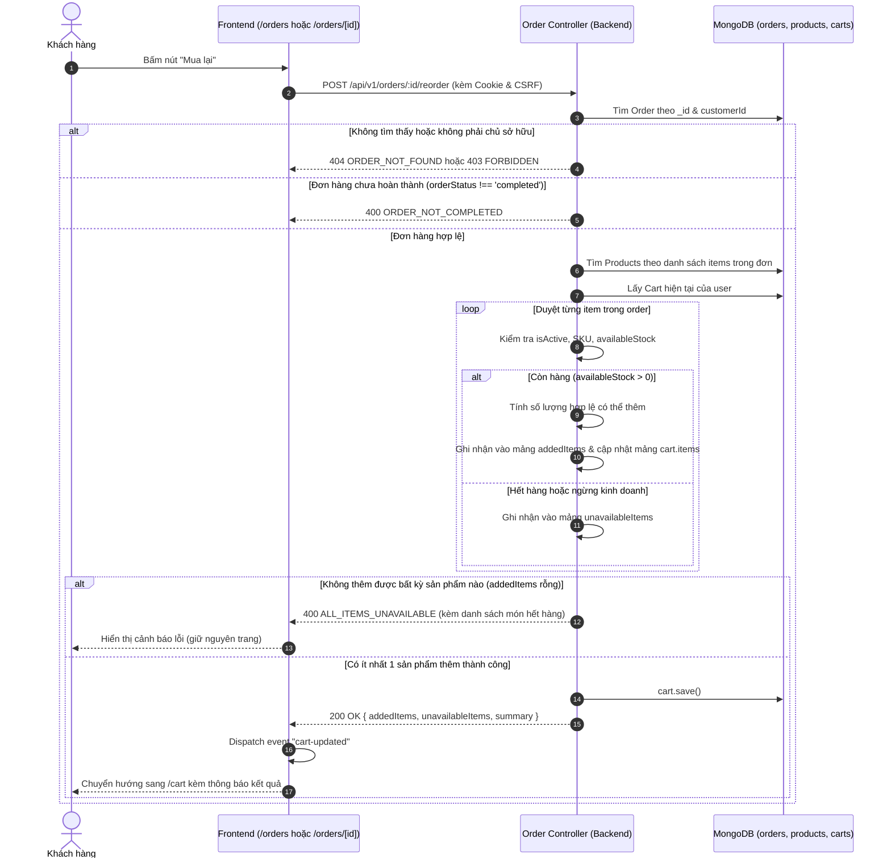

# Data Model & State Transitions: Mua Lại Đơn Hàng Đã Hoàn Thành (Reorder Completed Orders)

**Feature**: `reorder-completed-orders`  
**Date**: 2026-11-14  

---

## 1. Thực thể Tham gia Luồng Mua Lại (Entities)

### 1.1. Collection `orders` ([backend/src/models/order.model.js](../../../backend/src/models/order.model.js))
- Là **nguồn dữ liệu đầu vào** cho thao tác mua lại.
- Các trường được đọc từ đơn hàng:
  - `_id`: ObjectId của đơn hàng.
  - `orderCode`: Mã đơn hàng hiển thị (ví dụ `PA261012018`).
  - `customerId`: ObjectId của chủ sở hữu đơn hàng (dùng để xác thực phân quyền).
  - `orderStatus`: Phải bằng `"completed"` (điều kiện tiên quyết).
  - `items`: Mảng các sản phẩm trong đơn cũ:
    ```typescript
    Array<{
      productId: ObjectId;
      variantSku: string;
      qty: number;
    }>
    ```

---

### 1.2. Collection `products` ([backend/src/models/product.model.js](../../../backend/src/models/product.model.js))
- Dùng để **kiểm tra tính khả dụng, tồn kho và giá niêm yết hiện hành**:
  - `isActive`: Boolean. Phải là `true`. Nếu `false`, sản phẩm bị coi là ngừng kinh doanh.
  - `variants`: Mảng biến thể của sản phẩm. Mỗi biến thể có:
    - `sku`: String (đối chiếu với `variantSku`).
    - `stock`: Number (số lượng thực tế).
    - `reservedStock`: Number (số lượng đang được giữ chỗ).
    - `price`: Number (giá bán hiện tại của biến thể).
  - **Công thức tính tồn kho khả dụng hiện hành**:
    $$\text{availableStock} = \max(0, \text{variant.stock} - \text{variant.reservedStock})$$

---

### 1.3. Collection `carts` ([backend/src/models/cart.model.js](../../../backend/src/models/cart.model.js))
- Là **đích đến** của các sản phẩm được mua lại.
- Document giỏ hàng của khách hàng:
  ```typescript
  {
    userId: ObjectId,
    items: Array<{
      productId: ObjectId,
      variantSku: string,
      quantity: number
    }>
  }
  ```
- **Quy tắc cộng dồn**:
  - Nếu `(productId, variantSku)` đã tồn tại trong `cart.items`:
    $$\text{newQty} = \min(\text{currentQty} + \text{qtyToAdd}, \text{availableStock})$$
  - Nếu `(productId, variantSku)` chưa có trong giỏ:
    Thêm mới phần tử `{ productId, variantSku, quantity: qtyToAdd }`.

---

## 2. Luồng Xử lý Dữ liệu & Chuyển Trạng thái (Data Flow & State Flow)



---

## 3. Cấu trúc Đối tượng DTO Trả về (Response DTO Schema)

Khi gọi `POST /api/v1/orders/:id/reorder` thành công:

```json
{
  "success": true,
  "message": "Đã thêm các sản phẩm vào giỏ hàng thành công.",
  "data": {
    "orderCode": "PA261012018",
    "addedCount": 2,
    "unavailableCount": 1,
    "addedItems": [
      {
        "productId": "607f1f77bcf86cd799439011",
        "variantSku": "PET-001",
        "name": "Hạt Royal Canin Mini Adult",
        "quantity": 2,
        "price": 250000
      }
    ],
    "unavailableItems": [
      {
        "productId": "607f1f77bcf86cd799439012",
        "variantSku": "PET-002",
        "name": "Pate cho mèo vị cá ngừ",
        "reason": "OUT_OF_STOCK"
      }
    ],
    "cart": {
      "summary": {
        "distinctCount": 3,
        "totalQuantity": 5,
        "total": 650000
      }
    }
  }
}
```
