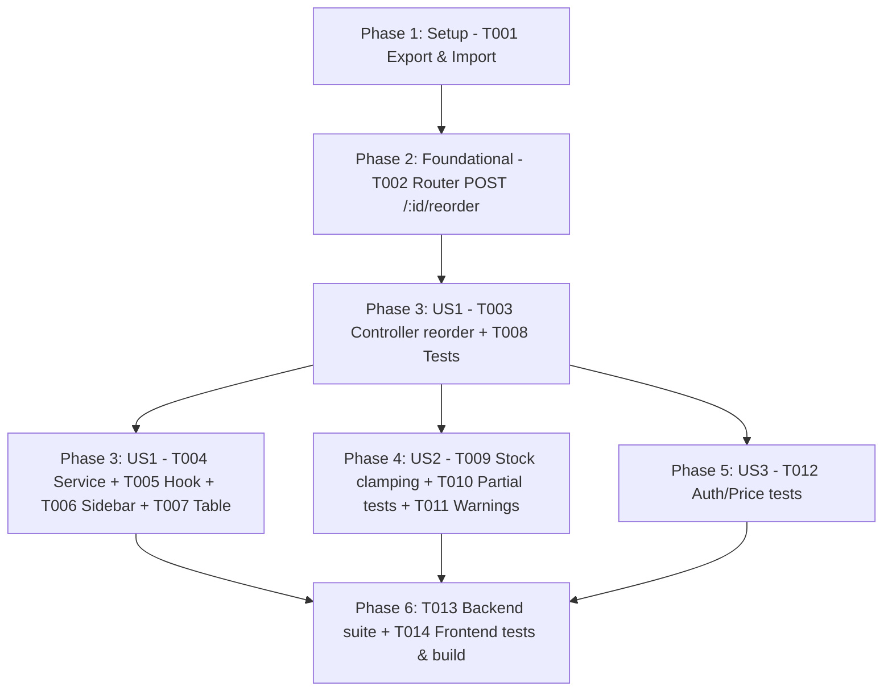

# Tasks: Tính Năng Mua Lại Cho Các Đơn Hàng Đã Hoàn Thành (Reorder Completed Orders)

**Input**: Design documents from `docs/specs/reorder-completed-orders/` (`spec.md`, `plan.md`, `research.md`, `data-model.md`, `contracts/reorder-api.yaml`, `quickstart.md`)  
**Prerequisites**: `spec.md`, `plan.md`, `data-model.md`, `contracts/reorder-api.yaml`  
**Tests**: Unit tests in `backend/tests/reorder.test.js`, full frontend tests (`npm.cmd --prefix frontend test`), and production build verification (`npm.cmd --prefix frontend run build`).  
**Organization**: Setup, Foundational, 3 User Story phases (`US1`, `US2`, `US3`), and Polish/Verification.

## Format: `- [ ] [TaskID] [P?] [Story?] Description with file path`

- **[P]**: Parallelizable (different files, no blocking incomplete dependencies)
- **[Story]**: User story label (`[US1]`, `[US2]`, `[US3]`)
- Every task includes an explicit, unambiguous file path.

---

## Phase 1: Setup

**Purpose**: Chuẩn bị router và import hàm xử lý reorder trong hệ thống đơn hàng.

- [X] T001 Export `reorderCompletedOrder` declaration in `backend/src/controllers/order.controller.js` and import it in `backend/src/routers/order.router.js`

---

## Phase 2: Foundational

**Purpose**: Đăng ký route và middleware bảo mật cho endpoint mua lại đơn hàng.

**⚠️ CRITICAL**: Phải hoàn thành giai đoạn này trước khi triển khai các User Story chi tiết.

- [X] T002 Register route `POST /:id/reorder` with `noStore, requireAuth, requireRole("customer"), protectMutation, reorderCompletedOrder` in `backend/src/routers/order.router.js`

---

## Phase 3: User Story 1 - Mua lại nhanh từ Chi tiết đơn hàng và Danh sách đơn hàng (Priority: P1) 🎯 MVP

**Goal**: Khách hàng bấm "Mua lại" trên đơn hàng đã hoàn thành (`orderStatus: "completed"`), hệ thống tự động thêm sản phẩm khả dụng vào giỏ hàng, cập nhật badge giỏ hàng trên TopBar và chuyển hướng sang `/cart`.

**Independent Test**: Gọi `POST /api/v1/orders/:id/reorder` với đơn hàng hoàn thành có các sản phẩm còn hàng. Xác nhận sản phẩm được thêm vào `Cart` của khách hàng với số lượng chính xác, và giao diện chuyển hướng sang `/cart`.

### Implementation for User Story 1

- [X] T003 [US1] Implement `reorderCompletedOrder` handler in `backend/src/controllers/order.controller.js` verifying `order.customerId.toString() === request.user._id.toString()`, verifying `order.orderStatus === "completed"`, looking up active products, adding items into user's `Cart` with atomic `cart.save()`, and returning 200 with `addedCount`, `addedItems`, and cart summary
- [X] T004 [P] [US1] Create `frontend/features/orders/services/reorder.service.ts` implementing `reorderCompletedOrderApi(id: string)` with CSRF fetching from `/api/v1/auth/csrf` and `POST /api/v1/orders/:id/reorder` using `credentials: "include"` and `cache: "no-store"`
- [X] T005 [P] [US1] Create `frontend/features/orders/hooks/use-reorder.ts` managing `isReordering` state, error state, calling `reorderCompletedOrderApi`, dispatching `window.dispatchEvent(new Event("cart-updated"))`, saving flash notification to `sessionStorage`, and navigating to `/cart` via `router.push('/cart')`
- [X] T006 [P] [US1] Update `OrderSummarySidebar` in `frontend/features/orders/components/order-summary-sidebar.tsx` to render the primary "Mua lại đơn hàng" action button when `order.orderStatusCode === "completed"` with loading spinner and disabled state when reordering is in progress
- [X] T007 [P] [US1] Update `OrdersTable` in `frontend/features/orders/components/orders-table.tsx` to render a "Mua lại" button in the actions column for any order row where `order.status === "completed"`
- [X] T008 [P] [US1] Create `backend/tests/reorder.test.js` with unit tests verifying that `POST /api/v1/orders/:id/reorder` on a completed order adds items into the customer's cart and returns 200

---

## Phase 4: User Story 2 - Xử lý thông minh khi một phần hoặc toàn bộ sản phẩm hết hàng / ngừng bán (Priority: P1)

**Goal**: Đơn hàng cũ có một số sản phẩm hết hàng hoặc ngừng kinh doanh (`isActive: false`): hệ thống vẫn thêm các sản phẩm còn hàng vào giỏ hàng và trả về danh sách `unavailableItems`; nếu toàn bộ đều hết hàng thì từ chối với mã lỗi `ALL_ITEMS_UNAVAILABLE` (400) mà không sửa đổi giỏ hàng.

**Independent Test**: Gọi reorder trên đơn hàng có 1 sản phẩm còn hàng và 1 sản phẩm hết hàng, xác nhận trả về `addedCount: 1`, `unavailableCount: 1` và giỏ hàng chỉ có sản phẩm còn hàng; gọi reorder trên đơn hàng toàn bộ sản phẩm hết hàng, xác nhận trả về lỗi 400 `ALL_ITEMS_UNAVAILABLE`.

### Implementation for User Story 2

- [X] T009 [US2] Enhance `reorderCompletedOrder` in `backend/src/controllers/order.controller.js` to compute `availableStock = Math.max(0, stock - reservedStock)`, clamp added quantity by available stock, populate `unavailableItems` for out-of-stock or inactive products, and throw `AppError("Rất tiếc, tất cả các sản phẩm trong đơn hàng này hiện đã hết hàng hoặc ngừng kinh doanh.", 400, "ALL_ITEMS_UNAVAILABLE", { unavailableItems })` when `addedItems.length === 0`
- [X] T010 [P] [US2] Add unit tests in `backend/tests/reorder.test.js` covering partial availability (clamping quantity to available stock, recording unavailable items) and total unavailability (rejecting with 400 `ALL_ITEMS_UNAVAILABLE`)
- [X] T011 [P] [US2] Update `useReorder` hook in `frontend/features/orders/hooks/use-reorder.ts` and notification display to handle partial availability warnings and show clear alerts when all items are unavailable without redirecting

---

## Phase 5: User Story 3 - Bảo mật, Phân quyền & Giá niêm yết hiện hành (Priority: P2)

**Goal**: Ngăn chặn mua lại đơn hàng của người khác, từ chối đơn hàng chưa hoàn thành (`ORDER_NOT_COMPLETED`), và đảm bảo giỏ hàng nhận giá niêm yết hiện hành của sản phẩm thay vì giá cũ trong lịch sử đơn hàng.

**Independent Test**: Gọi API reorder với ID đơn hàng của người khác (xác nhận 404/403), đơn hàng đang ở trạng thái `pending` hoặc `shipping` (xác nhận 400 `ORDER_NOT_COMPLETED`), và kiểm tra đơn giá sản phẩm trong giỏ hàng phản ánh đúng `variant.price` hiện tại.

### Implementation for User Story 3

- [X] T012 [P] [US3] Add unit tests in `backend/tests/reorder.test.js` verifying that `POST /api/v1/orders/:id/reorder` rejects non-completed orders with 400 `ORDER_NOT_COMPLETED`, rejects orders owned by other users with 404 `ORDER_NOT_FOUND`, and confirms added cart items reflect current product prices

---

## Phase 6: Polish & Cross-Cutting Verification

**Purpose**: Kiểm tra cú pháp, chạy toàn bộ bộ kiểm thử tự động của Backend và Frontend, và biên dịch build production.

- [X] T013 Run backend test suite via `npm.cmd --prefix backend test tests/reorder.test.js` and verify all tests pass
- [X] T014 [P] Run frontend test suite via `npm.cmd --prefix frontend test` and build production via `npm.cmd --prefix frontend run build` to confirm zero lint/type errors and zero bundle breakages

---

## Dependencies & Execution Sequence

### User Story Dependencies & MVP Scope
- **Phase 1 & Phase 2**: Nền tảng router và middleware bắt buộc.
- **Phase 3 (User Story 1)**: 🎯 **MVP** - Luồng cốt lõi: Backend reorder controller + Frontend service, hook và nút bấm trên Sidebar & Table.
- **Phase 4 (User Story 2)**: Xử lý thông minh khi một phần hoặc toàn bộ sản phẩm hết hàng.
- **Phase 5 (User Story 3)**: Kiểm soát an ninh, phân quyền và đảm bảo giá niêm yết hiện hành.
- **Phase 6**: Kiểm thử toàn diện và nghiệm thu bản build.
