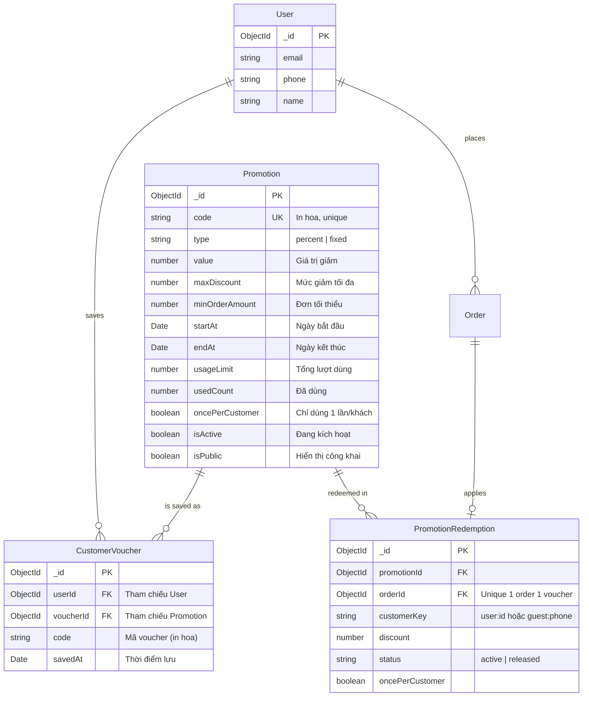

# Data Model: Quản Lý và Lưu Mã Giảm Giá Khách Hàng (Customer Voucher Wallet)

**Feature**: `save-customer-vouchers` | **Date**: 2026-11-09 | **Spec**: [spec.md](./spec.md)

Tài liệu này định nghĩa chi tiết mô hình dữ liệu, cấu trúc Schema Mongoose, chỉ mục (indexes), các quan hệ thực thể và máy trạng thái phục vụ tính năng "Lưu mã giảm giá và xem lại trên UI".

---

## 1. Sơ đồ quan hệ thực thể (ERD)



---

## 2. Chi tiết thực thể `CustomerVoucher`

### Collection: `customerVouchers`

| Tên trường | Kiểu dữ liệu | Bắt buộc | Mặc định | Mô tả |
| :--- | :--- | :---: | :---: | :--- |
| `_id` | `ObjectId` | Có | Tự sinh | Định danh duy nhất của bản ghi lưu voucher. |
| `userId` | `ObjectId` | Có | Không | ID của người dùng sở hữu voucher (liên kết bảng `users`). |
| `voucherId` | `ObjectId` | Có | Không | ID của voucher được lưu (liên kết bảng `promotions`). |
| `code` | `String` | Có | Không | Mã giảm giá dạng chuỗi (in hoa, cắt khoảng trắng, ví dụ: `PETJOY10`). Lưu trữ trực tiếp để tiện hiển thị và truy vấn nhanh. |
| `savedAt` | `Date` | Có | `Date.now` | Thời điểm khách hàng bấm lưu mã vào ví. |
| `createdAt` | `Date` | Tự động | `Date.now` | Thời gian tạo bản ghi (Mongoose timestamp). |
| `updatedAt` | `Date` | Tự động | `Date.now` | Thời gian cập nhật bản ghi gần nhất. |

### Chỉ mục cơ sở dữ liệu (Indexes)

1. **Unique Compound Index (Chống lưu trùng lặp)**:
   ```javascript
   customerVoucherSchema.index({ userId: 1, voucherId: 1 }, { unique: true });
   ```
   *Mục đích*: Đảm bảo mỗi người dùng chỉ có thể lưu một mã giảm giá đúng 1 lần duy nhất trong ví, chống race condition khi click nhanh.

2. **Index truy vấn danh sách & Sắp xếp thời gian**:
   ```javascript
   customerVoucherSchema.index({ userId: 1, savedAt: -1 });
   ```
   *Mục đích*: Tối ưu hóa tốc độ truy vấn danh sách mã trong ví của một người dùng cụ thể, sắp xếp mã mới lưu lên đầu tiên.

3. **Index truy vấn theo mã code**:
   ```javascript
   customerVoucherSchema.index({ userId: 1, code: 1 });
   ```
   *Mục đích*: Phục vụ thao tác kiểm tra hoặc hủy lưu nhanh theo mã code mà khách hàng gửi lên từ giao diện.

---

## 3. Máy trạng thái Voucher trong Ví (Computed State Machine)

Trạng thái của một voucher khi người dùng xem trong ví không lưu cứng vào DB mà được tính toán động (computed) dựa trên trạng thái của `Promotion` gốc và lịch sử `PromotionRedemption`:

```mermaid
stateDiagram-v2
    [*] --> Ready: Khách hàng bấm "Lưu mã"

    state Ready {
        description: Còn hạn (now < endAt), còn lượt dùng, isActive=true, chưa sử dụng
    }

    state Used {
        description: Đã sử dụng thành công trong đơn hàng (PromotionRedemption.status = active)
    }

    state Expired {
        description: Hết hạn ngày (now >= endAt), hoặc hết lượt toàn sàn, hoặc bị admin vô hiệu hóa
    }

    Ready --> Used: Đặt hàng thành công với mã này (oncePerCustomer)
    Used --> Ready: Đơn hàng bị Hủy (Order cancelled -> Redemption released)
    Ready --> Expired: Quá thời gian endAt / Hết lượt usageLimit
```

### Bảng logic trạng thái (State Rules Table)

| Trạng thái | Điều kiện xác định | Khả năng áp dụng | Tab hiển thị trên UI |
| :--- | :--- | :---: | :--- |
| **`ready`** (Sẵn sàng) | `Promotion.isActive === true` <br> `now >= startAt && now < endAt` <br> `usedCount < usageLimit` <br> Không có `PromotionRedemption` active của khách | **Có thể dùng** (nếu đạt giá trị đơn hàng tối thiểu) | Tab **"Có hiệu lực"** |
| **`used`** (Đã sử dụng) | Tồn tại `PromotionRedemption` với `customerKey === "user:<userId>"` và `status === "active"` | Không thể dùng lại | Tab **"Đã sử dụng"** |
| **`expired`** (Hết hiệu lực) | `now >= Promotion.endAt` <br> hoặc `Promotion.isActive === false` <br> hoặc `usedCount >= usageLimit` | Không thể dùng | Tab **"Hết hiệu lực"** |

---

## 4. Cấu trúc Schema Mongoose mẫu (`backend/src/models/customer-voucher.model.js`)

```javascript
import mongoose from "mongoose";

const customerVoucherSchema = new mongoose.Schema(
  {
    userId: {
      type: mongoose.Schema.Types.ObjectId,
      ref: "User",
      required: true,
      index: true,
    },
    voucherId: {
      type: mongoose.Schema.Types.ObjectId,
      ref: "Promotion",
      required: true,
    },
    code: {
      type: String,
      required: true,
      trim: true,
      uppercase: true,
    },
    savedAt: {
      type: Date,
      default: Date.now,
      required: true,
    },
  },
  {
    collection: "customerVouchers",
    timestamps: true,
    bufferCommands: false,
  }
);

customerVoucherSchema.index({ userId: 1, voucherId: 1 }, { unique: true });
customerVoucherSchema.index({ userId: 1, savedAt: -1 });

export const CustomerVoucher =
  mongoose.models.CustomerVoucher ||
  mongoose.model("CustomerVoucher", customerVoucherSchema);
```

