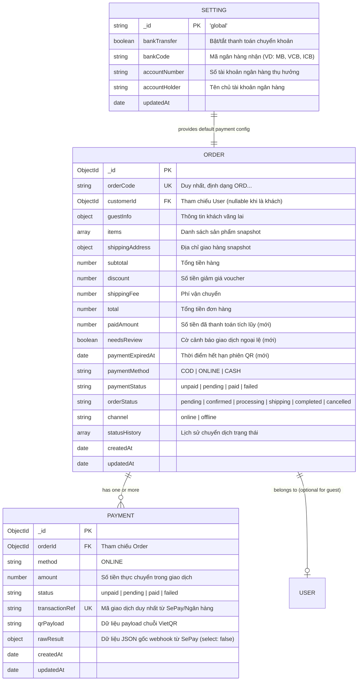
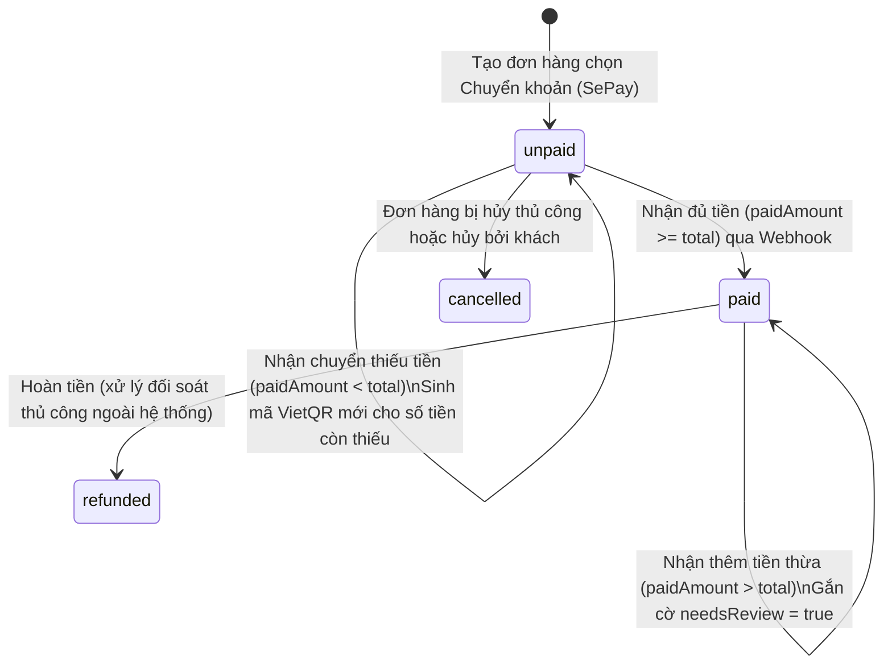

# Data Model: Tích Hợp Thanh Toán Chuyển Khoản Qua SePay (VietQR)

**Feature**: `sepay-transfer-payment` | **Spec**: [spec.md](./spec.md)

Tài liệu này định nghĩa chi tiết mô hình dữ liệu, các thuộc tính, mối quan hệ thực thể, ràng buộc xác thực và máy trạng thái (State Machine) phục vụ tính năng thanh toán chuyển khoản qua SePay.

---

## 1. Sơ đồ thực thể và mối quan hệ (ERD)

---

## 2. Chi tiết các trường dữ liệu và ràng buộc

### 2.1. Cập nhật Model `Order` (`backend/src/models/order.model.js`)

| Trường | Kiểu dữ liệu | Bắt buộc | Mặc định | Mô tả & Ràng buộc |
| :--- | :--- | :---: | :---: | :--- |
| `paidAmount` | `Number` | Có | `0` | Số tiền thực tế khách hàng đã chuyển khoản thành công tích lũy. Ràng buộc: Số nguyên không âm (`nonNegativeInteger`). |
| `needsReview` | `Boolean` | Có | `false` | Cờ cảnh báo đơn hàng phát sinh giao dịch ngoại lệ (chuyển thừa tiền, hoặc chuyển khoản sau khi đã đổi phương thức sang COD) cần nhân viên liên hệ đối soát/hoàn tiền. |
| `paymentExpiredAt` | `Date` | Không | `now + 15m` | Thời điểm hết hạn phiên thanh toán VietQR hiện tại (được cập nhật mới khi gia hạn). |

### 2.2. Model `Payment` (`backend/src/models/payment.model.js`)

| Trường | Kiểu dữ liệu | Bắt buộc | Mặc định | Mô tả & Ràng buộc |
| :--- | :--- | :---: | :---: | :--- |
| `orderId` | `ObjectId` | Có | - | Tham chiếu `Order._id`. Index hỗ trợ truy vấn `{ orderId: 1, createdAt: -1 }`. |
| `method` | `String` | Có | - | Giá trị: `"ONLINE"`. |
| `amount` | `Number` | Có | - | Số tiền nhận được trong lần chuyển khoản này. Ràng buộc: Số nguyên dương an toàn (`nonNegativeInteger`). |
| `status` | `String` | Có | `"paid"` | Trạng thái của lần giao dịch: `"paid"` khi webhook hợp lệ được ghi nhận. |
| `transactionRef` | `String` | Có | - | Mã định danh duy nhất của giao dịch do SePay gửi về (`id` hoặc `referenceCode`). Index duy nhất: `unique: true, partialFilterExpression: { transactionRef: { $type: "string" } }`. Đảm bảo tính bất biến (Idempotency). |
| `qrPayload` | `String` | Không | - | Chuỗi văn bản VietQR được tạo ra cho phiên thanh toán. |
| `rawResult` | `Mixed` | Không | - | Toàn bộ payload JSON của Webhook gửi từ SePay. Cấu hình `select: false` để bảo mật và không lộ ra API công khai (tuân thủ CR-08). |

### 2.3. Cập nhật Model `Setting` (`backend/src/models/setting.model.js`)

| Trường | Kiểu dữ liệu | Bắt buộc | Mặc định | Mô tả |
| :--- | :--- | :---: | :---: | :--- |
| `bankTransfer` | `Boolean` | Có | `true` | Bật hoặc tắt phương thức thanh toán chuyển khoản trên hệ thống. |
| `bankCode` | `String` | Không | `"MB"` | Mã ngân hàng nhận tiền theo chuẩn VietQR (VD: `MB`, `VCB`, `TCB`, `ICB`). |
| `accountNumber` | `String` | Không | `""` | Số tài khoản ngân hàng nhận tiền. |
| `accountHolder` | `String` | Không | `""` | Tên chủ tài khoản thụ hưởng. |

---

## 3. Máy trạng thái thanh toán & Đơn hàng (State Machine Transitions)

### 3.1. Vòng đời Trạng thái Thanh toán (`Order.paymentStatus`)

### 3.2. Vòng đời Trạng thái Đơn hàng (`Order.orderStatus`) và Mối liên hệ với Thanh toán

| Trạng thái hiện tại | Sự kiện kích hoạt | Điều kiện kiểm tra | Trạng thái tiếp theo | Ghi chú nghiệp vụ |
| :--- | :--- | :--- | :--- | :--- |
| `pending` (unpaid) | Hết hạn 15 phút | Chưa nhận được tiền | `pending` (unpaid) | Mã QR hết hạn; giao diện cho phép tạo mã mới hoặc chuyển sang COD. |
| `pending` (unpaid) | Khách bấm "Đổi sang COD" | Phiên QR hết hạn | `pending` (COD / unpaid) | Đổi `paymentMethod = "COD"`. Đơn giữ nguyên để chuẩn bị giao hàng. |
| `pending` (unpaid) | Webhook SePay nhận đủ tiền | `paidAmount >= total` | `pending` (paid) | Thanh toán hoàn tất, đơn hàng đủ điều kiện để nhân viên xác nhận (`BR-18`). |
| `pending` (paid) | Nhân viên bấm "Xác nhận đơn" | `paymentStatus === "paid"` và đủ tồn kho | `confirmed` (paid) | Tuân thủ nghiêm ngặt `BR-18`. Nếu chưa `paid` thì hành động bị từ chối với mã lỗi `PAYMENT_NOT_VERIFIED`. |
| `confirmed` (paid) | Xử lý kho và đóng gói | - | `processing` | Luồng xử lý đơn hàng tiêu chuẩn. |

