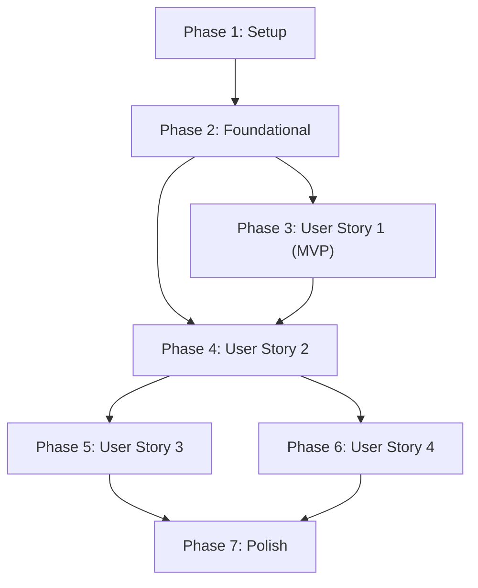

# Tasks: Tích Hợp Thanh Toán Chuyển Khoản Qua SePay (VietQR)

**Input**: Design documents from `docs/specs/sepay-transfer-payment/` (`plan.md`, `spec.md`, `research.md`, `data-model.md`, `contracts/sepay-payment-api.yaml`, `quickstart.md`)

**Prerequisites**: `plan.md`, `spec.md`, `data-model.md`, `contracts/sepay-payment-api.yaml`

**Tests**: Bao gồm các bài kiểm thử tự động với Vitest (`backend/tests/sepay-payment.test.js`) và kịch bản xác minh chạy qua ngrok theo `quickstart.md`.

**Organization**: Các nhiệm vụ được nhóm theo từng kịch bản người dùng (User Story) để đảm bảo tính độc lập khi triển khai và kiểm thử từng phần.

## Format: `[ID] [P?] [Story] Description with file path`

- **[P]**: Có thể thực hiện song song (khác tệp tin, không phụ thuộc nhiệm vụ chưa xong)
- **[Story]**: Gắn với User Story tương ứng (`[US1]`, `[US2]`, `[US3]`, `[US4]`)
- Tệp tin được chỉ định rõ ràng với đường dẫn tuyệt đối hoặc tương đối chuẩn trong dự án.

---

## Phase 1: Setup (Shared Infrastructure & Environment)

**Purpose**: Thiết lập biến môi trường, cấu hình SePay và các schema xác thực đầu vào.

- [X] T001 [P] Configure SePay environment variables in `backend/src/config/env.js` and update `backend/.env.example` with `SEPAY_API_KEY`, `SEPAY_BANK_CODE`, `SEPAY_ACCOUNT_NUMBER`, and `SEPAY_ACCOUNT_HOLDER`
- [X] T002 [P] Create SePay Webhook Zod validation schema in `backend/src/validators/payment.validator.js` validating `id`, `gateway`, `transactionDate`, `accountNumber`, `transferType` enum `['in', 'out']`, `transferAmount` non-negative integer, and `content`

---

## Phase 2: Foundational (Blocking Prerequisites)

**Purpose**: Hạ tầng lõi, mở rộng Schema Mongoose, tiện ích VietQR và bộ định tuyến API bắt buộc trước khi triển khai các User Story.

**⚠️ CRITICAL**: Phải hoàn thành toàn bộ giai đoạn này trước khi bắt đầu các User Story.

- [X] T003 Update Order schema in `backend/src/models/order.model.js` adding `paidAmount` (type Number, `nonNegativeInteger`, default 0), `needsReview` (type Boolean, default false), and `paymentExpiredAt` (type Date)
- [X] T004 [P] Update Setting schema in `backend/src/models/setting.model.js` ensuring `bankTransfer` (Boolean, default true), `bankCode` (String, default 'MB'), `accountNumber` (String), and `accountHolder` (String)
- [X] T005 [P] Create SePay helper service in `backend/src/common/sepay-service.js` with functions to generate VietQR URLs (`https://qr.sepay.vn/img?acc=...&bank=...&amount=...&des=...`), format transfer memos as `PETJOY <orderCode>`, and parse order codes from transaction content using regex `/PETJOY\s+(ORD\d+)/i`
- [X] T006 [P] Create SePay Webhook authentication middleware in `backend/src/common/middlewares/sepay-auth.js` validating the `Authorization: Apikey <SEPAY_API_KEY>` header and returning 401 `UNAUTHORIZED` on mismatch
- [X] T007 Create payment router in `backend/src/routers/payment.router.js` and mount it at `/api/v1/payments` in `backend/src/app.js`

**Checkpoint**: Nền tảng dữ liệu và định tuyến hoàn tất - sẵn sàng triển khai User Story 1.

---

## Phase 3: User Story 1 - Khách hàng chọn thanh toán chuyển khoản và quét mã VietQR tự động (Priority: P1) 🎯 MVP

**Goal**: Khách hàng chọn Chuyển khoản ngân hàng tại checkout, tạo đơn hàng thành công, hiển thị modal/thẻ VietQR động chính xác số tiền, số tài khoản và nội dung `PETJOY <orderCode>` kèm nút sao chép nhanh.

**Independent Test**: Đặt một đơn hàng chọn phương thức thanh toán chuyển khoản SePay và xác minh màn hình hiển thị đầy đủ mã VietQR hợp lệ, thông tin chuyển khoản và nút sao chép hoạt động trơn tru.

### Implementation for User Story 1

- [X] T008 [P] [US1] Implement `GET /api/v1/payments/sepay/info/:orderCode` in `backend/src/controllers/payment.controller.js` returning `orderCode`, `total`, `paidAmount`, `remainingAmount`, `bankCode`, `accountNumber`, `accountHolder`, `memo`, `qrUrl`, `qrPayload`, `paymentExpiredAt`, and `secondsLeft`
- [X] T009 [P] [US1] Update checkout payment types in `frontend/features/checkout/types.ts` adding `'sepay'` to `PaymentMethodType` (`"vnpay" | "cod" | "sepay"`)
- [X] T010 [P] [US1] Add "Chuyển khoản ngân hàng (VietQR qua SePay)" option with bank icon and description to `frontend/features/checkout/components/payment-method-card.tsx`
- [X] T011 [US1] Update `frontend/features/checkout/hooks/use-checkout.ts` to support `'sepay'` payment method mapping to `ONLINE` on backend and redirecting to the payment result view with `orderCode` and `paymentMethod`
- [X] T012 [P] [US1] Create VietQR payment transfer card component in `frontend/features/checkout/components/sepay-transfer-card.tsx` displaying dynamic VietQR image, account number, bank name, account holder, amount, memo, countdown timer, and quick copy-to-clipboard buttons
- [X] T013 [US1] Integrate `sepay-transfer-card` into `frontend/features/checkout/components/payment-result-view.tsx` when `paymentMethod` is `ONLINE` and order is not yet paid

**Checkpoint**: User Story 1 hoàn thành - Khách hàng có thể đặt đơn hàng và quét mã VietQR chuyển khoản (MVP hoàn tất).

---

## Phase 4: User Story 2 - Tự động ghi nhận thanh toán thành công qua SePay Webhook và cập nhật giao diện (Priority: P1)

**Goal**: Xử lý Webhook SePay khi có tiền vào tài khoản ngân hàng, đối soát mã đơn và số tiền, đảm bảo tính bất biến (Idempotency), cập nhật `paymentStatus = "paid"` và tự động cập nhật giao diện người mua qua Polling 3s + nút kiểm tra.

**Independent Test**: Gửi một cURL webhook mô phỏng từ cổng thanh toán khớp mã đơn và kiểm tra trạng thái đơn hàng đổi thành `paid` và giao diện người mua lập tức chuyển sang "Thanh toán thành công".

### Implementation for User Story 2

- [X] T014 [US2] Implement `POST /api/v1/payments/sepay/webhook` in `backend/src/controllers/payment.controller.js` with Idempotency check on `Payment.transactionRef`, order matching via regex, and updating `Order.paymentStatus = 'paid'` when `paidAmount >= total` (BR-15, BR-16, CR-06)
- [X] T015 [P] [US2] Implement `GET /api/v1/payments/status/:orderCode` endpoint in `backend/src/controllers/payment.controller.js` returning lightweight payment status (`paymentStatus`, `paidAmount`, `remainingAmount`, `isPaid`, `isExpired`, `needsReview`)
- [X] T016 [P] [US2] Implement client API service functions in `frontend/services/payment-api.ts` for fetching payment info, polling status, renewing sessions, and converting to COD
- [X] T017 [US2] Implement custom hook `frontend/features/checkout/hooks/use-sepay-payment.ts` managing 3-second polling interval, manual 'Kiểm tra trạng thái' button trigger, countdown timer, and success transition state
- [X] T018 [US2] Update `frontend/features/checkout/components/sepay-transfer-card.tsx` with live polling integration, manual check button, and automated transition to success view upon payment confirmation
- [X] T019 [P] [US2] Add Vitest integration test in `backend/tests/sepay-payment.test.js` covering webhook authentication, happy path payment confirmation, and idempotent repeat delivery (BR-15, BR-16)

**Checkpoint**: User Story 2 hoàn thành - Tự động nhận biến động số dư và chuyển trạng thái đơn hàng thời gian thực.

---

## Phase 5: User Story 3 - Xử lý hết hạn phiên thanh toán và linh hoạt gia hạn hoặc đổi sang COD (Priority: P2)

**Goal**: Khi hết 15 phút đếm ngược, đơn hàng vẫn giữ `pending`; màn hình hiển thị thông báo hết hạn và cung cấp nút "Tạo lại mã thanh toán" (gia hạn 15p) hoặc "Chuyển sang thanh toán khi nhận hàng (COD)".

**Independent Test**: Mở màn hình thanh toán, để đồng hồ hết hạn và kiểm tra nút "Tạo lại mã thanh toán" gia hạn thêm 15 phút hoặc nút "Chuyển sang COD" chuyển đổi phương thức đơn sang COD thành công.

### Implementation for User Story 3

- [X] T020 [P] [US3] Implement `POST /api/v1/payments/renew-session/:orderCode` in `backend/src/controllers/payment.controller.js` resetting `paymentExpiredAt` to `now + 15 minutes` for pending unpaid orders
- [X] T021 [P] [US3] Implement `POST /api/v1/payments/convert-to-cod/:orderCode` in `backend/src/controllers/payment.controller.js` updating `Order.paymentMethod` to `'COD'` and `Order.paymentStatus` to `'unpaid'` without modifying items or applied voucher
- [X] T022 [US3] Update `frontend/features/checkout/components/sepay-transfer-card.tsx` to show expired state banner, hide old QR, and provide actionable "Tạo lại mã thanh toán" and "Chuyển sang thanh toán khi nhận hàng (COD)" buttons
- [X] T023 [US3] Add Vitest test in `backend/tests/sepay-payment.test.js` verifying session renewal and COD conversion behavior on expired orders

**Checkpoint**: User Story 3 hoàn thành - Xử lý hết hạn phiên thông minh, hạn chế rớt đơn và bảo lưu giỏ hàng/voucher.

---

## Phase 6: User Story 4 - Quản lý, kiểm soát và xác nhận đơn hàng chuyển khoản từ phía Nhân viên và Quản trị viên (Priority: P2)

**Goal**: Nhân viên xem rõ phương thức SePay và mã tham chiếu ngân hàng; chặn xác nhận đơn hàng nếu chưa `paid` (BR-18); gắn cờ `needsReview` khi khách chuyển thừa tiền hoặc chuyển sau khi đổi sang COD.

**Independent Test**: Thao tác xác nhận đơn hàng với tài khoản Nhân viên trên đơn chưa thanh toán (bị chặn BR-18), thanh toán thành công (xác nhận được), và kiểm tra cờ `needsReview` xuất hiện khi chuyển thừa tiền.

### Implementation for User Story 4

- [X] T024 [US4] Update Order confirmation handler in `backend/src/controllers/order.controller.js` to strictly enforce BR-18: reject order confirmation with 400 `PAYMENT_NOT_VERIFIED` if `paymentMethod` is `ONLINE` and `paymentStatus` is not `'paid'`
- [X] T025 [P] [US4] Update Webhook handler in `backend/src/controllers/payment.controller.js` to flag `Order.needsReview = true` when `paidAmount > total` (excess transfer) or when transaction arrives after `paymentMethod` was changed to `'COD'`
- [X] T026 [P] [US4] Update Staff and Admin order views in `frontend/features/staff/components/staff-order-detail.tsx` and `frontend/features/admin/components/admin-order-detail.tsx` to display SePay transaction reference, payment status badge, and 'Cần đối soát' alert badge when `needsReview` is true
- [X] T027 [US4] Add Vitest test in `backend/tests/sepay-payment.test.js` validating BR-18 confirmation blockage on unpaid SePay orders and needsReview flagging on excess transfers

**Checkpoint**: User Story 4 hoàn thành - Đảm bảo an toàn tài chính nội bộ và quy trình kiểm soát của Nhân viên/Quản trị viên.

---

## Phase 7: Polish & Cross-Cutting Concerns

**Purpose**: Hoàn thiện bảo mật, ghi nhật ký kiểm toán, làm sạch mã nguồn và xác minh toàn diện.

- [X] T028 [P] Add detailed structured audit logging in `backend/src/common/audit.js` for SePay Webhook events, order payment status transitions, and `needsReview` flags
- [X] T029 [P] Verify error responses and exception masking in `backend/src/controllers/payment.controller.js` ensuring no API keys, credentials, or stack traces leak to client (CR-08)
- [X] T030 Execute all quickstart validation scenarios from `docs/specs/sepay-transfer-payment/quickstart.md` using ngrok tunnel and record test results

---

## Dependencies & Execution Order

### Phase Dependencies

- **Phase 1 (Setup)**: Không có phụ thuộc, thực hiện ngay lập tức.
- **Phase 2 (Foundational)**: Phụ thuộc vào Phase 1; KHÓA (block) tất cả các User Story.
- **Phase 3 (User Story 1 - MVP)**: Phụ thuộc vào Phase 2. Cung cấp luồng thanh toán VietQR hiển thị cho khách hàng.
- **Phase 4 (User Story 2)**: Phụ thuộc vào Phase 2 và Phase 3. Tự động hóa tiếp nhận tiền qua Webhook.
- **Phase 5 (User Story 3)**: Phụ thuộc vào Phase 4. Bổ sung cơ chế hết hạn và đổi sang COD.
- **Phase 6 (User Story 4)**: Phụ thuộc vào Phase 4. Ràng buộc xác nhận đơn của Staff (BR-18) và cờ đối soát.
- **Phase 7 (Polish)**: Hoàn tất sau khi tất cả các User Story hoàn thành.

---

## Parallel Opportunities

- **Trong Phase 1**: T001 (Config env) và T002 (Validator) có thể chạy song song `[P]`.
- **Trong Phase 2**: T004 (Setting model), T005 (SePay service), T006 (Auth middleware) có thể chạy song song `[P]`.
- **Trong Phase 3 (US1)**: T008 (API info), T009 (Types), T010 (UI payment method), T012 (Card UI) có thể chạy song song `[P]`.
- **Trong Phase 4 (US2)**: T015 (API status), T016 (Client service), T019 (Vitest) có thể chạy song song `[P]`.
- **Trong Phase 5 (US3)**: T020 (API renew) và T021 (API convert COD) có thể chạy song song `[P]`.
- **Trong Phase 6 (US4)**: T025 (Webhook flag) và T026 (Workspace UI badge) có thể chạy song song `[P]`.

---

## Implementation Strategy

### MVP First (User Story 1 & 2)
1. Hoàn thành Phase 1 & Phase 2 (Hạ tầng dữ liệu & Router).
2. Hoàn thành Phase 3 (User Story 1 - Sinh mã VietQR động tại Checkout).
3. Hoàn thành Phase 4 (User Story 2 - Xử lý Webhook SePay qua ngrok và Polling 3s).
4. **Kiểm thử nghiệm thu MVP**: Khách quét mã QR và thanh toán tự động chuyển thành công.

### Incremental Delivery (User Story 3 & 4)
1. Thêm Phase 5: Xử lý hết hạn 15 phút, gia hạn và chuyển đổi sang COD.
2. Thêm Phase 6: Chặn xác nhận đơn hàng tại Staff Dashboard (BR-18) và gắn cờ `needsReview`.
3. Hoàn thiện Phase 7: Logging kiểm toán và chạy toàn bộ kịch bản kiểm thử ngrok.
