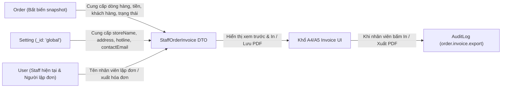
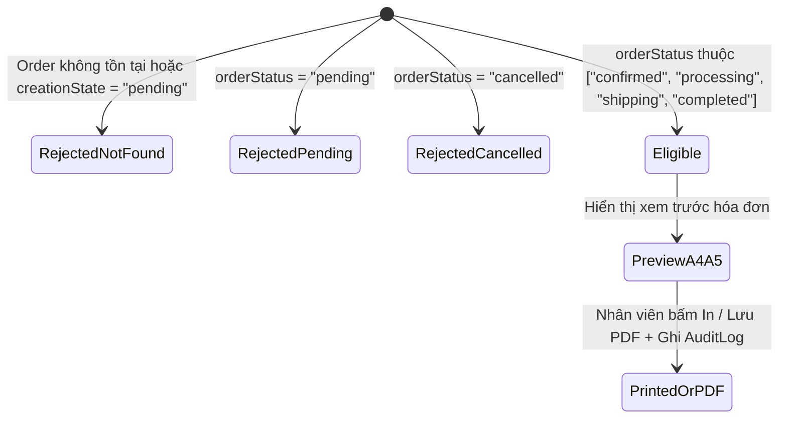

# Data Model: Staff Xuất Hóa Đơn Đơn Hàng (Staff Order Invoice)

**Feature**: `staff-order-invoice` | **Date**: 2026-11-11 | **Spec**: [spec.md](./spec.md)

Tài liệu này mô tả chi tiết các thực thể dữ liệu tham gia vào quá trình lập, hiển thị và kiểm toán thao tác xuất hóa đơn của nhân viên. Tính năng tái sử dụng hoàn toàn các collection hiện hữu (`orders`, `settings`, `users`, `auditLogs`) mà không cần tạo bảng cơ sở dữ liệu mới hay thay đổi schema lưu trữ đơn hàng.

---

## 1. Sơ đồ quan hệ dữ liệu (Data Sources & Relationships)



---

## 2. Nguồn thực thể & Quy tắc tổng hợp

### A. `Order` (`backend/src/models/order.model.js` - Read-Only Source)
Cung cấp dữ liệu snapshot tại thời điểm đặt hàng:
- **Định danh & thời gian**: `_id`, `orderCode`, `createdAt`, `channel` (`"online"` | `"offline"`), `orderStatus`, `creationState`.
- **Khách hàng & nhận hàng**:
  - `customerId` (nếu có tài khoản), `guestInfo` (`name`, `phone`, `email`), `email`.
  - `shippingAddress` (`recipientName`, `phone`, `province`, `district`, `ward`, `street`) — bắt buộc khi `channel === "online"`; với `channel === "offline"` dùng nhãn `"Nhận tại cửa hàng · Không giao hàng"`.
- **Chi tiết sản phẩm (`items[]`)**:
  - Mỗi dòng gồm: `variantSku`, `name`, `unitPrice`, `qty`, `lineTotal = unitPrice * qty`.
  - Không truy vấn lại giá hiện tại từ collection `products`.
- **Tài chính & Thanh toán**:
  - `subtotal`, `discount`, `promotionCode`, `shippingFee`, `total`.
  - `paymentMethod` (`"COD"` | `"ONLINE"` | `"CASH"`), `paymentStatus` (`"unpaid"` | `"pending"` | `"paid"` | `"failed"`).
  - `paidAmount`: Số tiền thực nhận tích lũy; nếu `paymentStatus === "paid"` mà `paidAmount` chưa được điền (đơn cũ/tiền mặt), coi như đã trả đủ `total`.
  - `remainingAmount = paymentStatus === "paid" ? 0 : Math.max(0, total - (paidAmount || 0))`.
  - `needsReview`: Cờ cảnh báo chênh lệch giao dịch thanh toán.

### B. `Setting` (`backend/src/models/setting.model.js` - Read-Only Source)
Truy vấn document duy nhất `_id: "global"`:
- `storeName`: Mặc định fallback `"Petjoy"` nếu trống hoặc chưa tồn tại document cấu hình.
- `address`, `hotline`, `contactEmail`: Chuỗi đã `trim()`; nếu rỗng sẽ trả về `""` để giao diện hóa đơn tự động ẩn dòng trống.

### C. `AuditLog` (`backend/src/models/audit-log.model.js` - Append-Only Export Trail)
Khi nhân viên thực hiện lệnh xuất/in hóa đơn (`POST /api/v1/staff/orders/:id/invoice/exports`), hệ thống ghi một bản ghi kiểm toán qua `recordAudit`:

| Trường | Giá trị lưu trữ |
| :--- | :--- |
| `actorId` | `_id` của tài khoản `staff` đang thực hiện xuất |
| `action` | `"order.invoice.export"` |
| `target` | `{ collectionName: "orders", id: String(order._id) }` |
| `after` | `{ orderCode: order.orderCode, orderStatus: order.orderStatus, total: order.total, channel: order.channel }` |
| `result` | `"success"` |
| `summary` | `` `Xuất hóa đơn đơn hàng #${order.orderCode}` `` |
| `ip` | Địa chỉ IP của request (`request.ip`) |
| `at` | Thời điểm xuất (`Date.now`) |

---

## 3. Quy tắc kiểm tra điều kiện xuất hóa đơn (Eligibility Rules)



| Điều kiện kiểm tra | Kết quả | Mã lỗi / Phản hồi |
| :--- | :---: | :--- |
| ID không phải ObjectId hợp lệ | Từ chối (400) | `VALIDATION_ERROR` |
| Không tìm thấy `Order` hoặc `creationState === "pending"` | Từ chối (404) | `ORDER_NOT_FOUND` |
| `orderStatus === "pending"` | Từ chối (409) | `INVOICE_NOT_ELIGIBLE` (*"Đơn hàng đang chờ xử lý, chỉ hỗ trợ xuất hóa đơn từ trạng thái Đã xác nhận trở lên."*) |
| `orderStatus === "cancelled"` | Từ chối (409) | `INVOICE_NOT_ELIGIBLE` (*"Đơn hàng đã hủy không thể xuất hóa đơn."*) |
| `orderStatus` thuộc `["confirmed", "processing", "shipping", "completed"]` | Hợp lệ (200/201) | Trả về `StaffOrderInvoice` DTO hoặc ghi nhận xuất |

---

## 4. Cấu trúc dữ liệu trả về `StaffOrderInvoice`

```json
{
  "store": {
    "name": "Petjoy",
    "address": "28 Nguyễn Thị Minh Khai, Quận 1, TP. HCM",
    "hotline": "1900 636 789",
    "email": "support@petjoy.vn"
  },
  "order": {
    "id": "6af421c1df30f03d607022dc",
    "orderCode": "ORD1794327303021111",
    "createdAt": "2026-11-11T08:05:21.782Z",
    "channel": "online",
    "orderStatus": "confirmed",
    "paymentMethod": "ONLINE",
    "paymentStatus": "paid",
    "customer": {
      "name": "Nguyễn Văn A",
      "phone": "0901234567",
      "email": "a@example.com"
    },
    "shippingAddress": {
      "recipientName": "Nguyễn Văn A",
      "phone": "0901234567",
      "province": "TP. Hồ Chí Minh",
      "district": "Quận 1",
      "ward": "Phường Bến Nghé",
      "street": "123 Lê Lợi"
    },
    "items": [
      {
        "variantSku": "RC-MA-2KG",
        "name": "Thức ăn hạt Royal Canin Mini Adult",
        "unitPrice": 320000,
        "qty": 2,
        "lineTotal": 640000
      }
    ],
    "subtotal": 640000,
    "discount": 50000,
    "promotionCode": "PET50K",
    "shippingFee": 0,
    "total": 590000,
    "paidAmount": 590000,
    "remainingAmount": 0,
    "needsReview": false,
    "createdByStaff": "Nhân viên Quầy 1"
  },
  "invoiceMeta": {
    "generatedAt": "2026-11-11T09:35:00.000Z",
    "generatedBy": "Nhân viên Quầy 1",
    "exportCount": 0
  }
}
```

