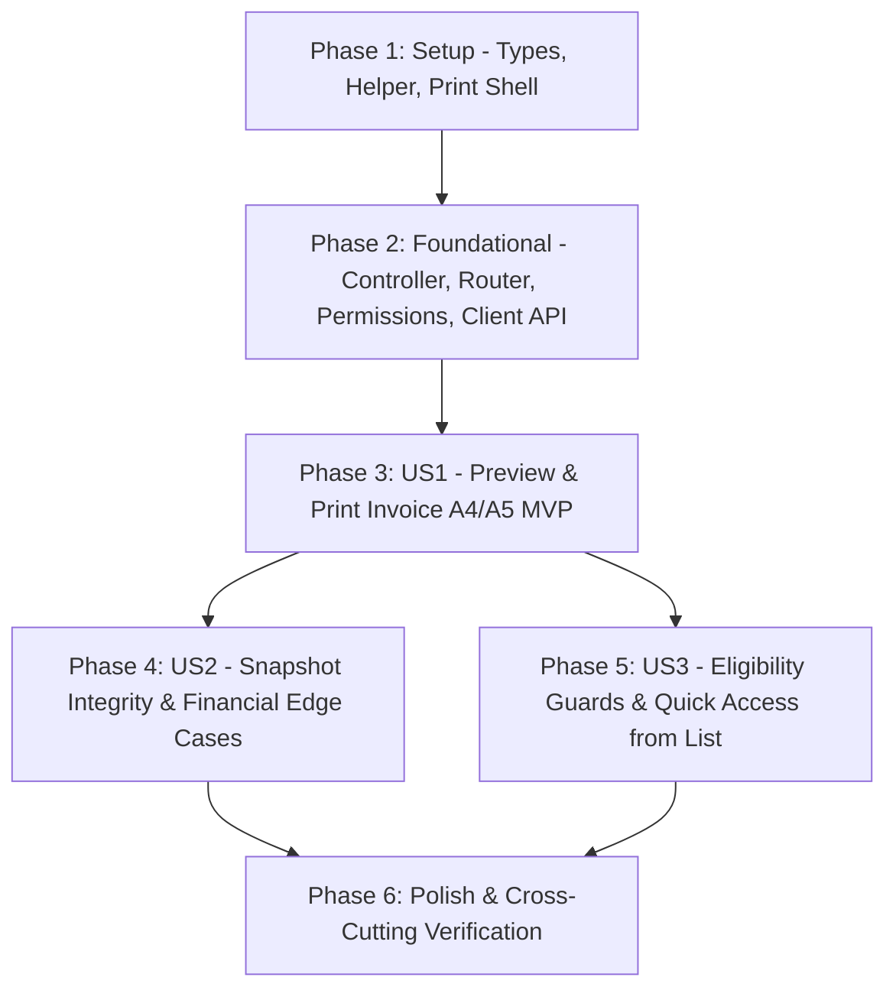

# Tasks: Staff Xuất Hóa Đơn Đơn Hàng (Staff Order Invoice)

**Input**: Design documents from `docs/specs/staff-order-invoice/` (`spec.md`, `plan.md`, `research.md`, `data-model.md`, `contracts/staff-order-invoice-api.yaml`, `quickstart.md`)

**Prerequisites**: `spec.md`, `plan.md`, `data-model.md`, `contracts/staff-order-invoice-api.yaml`

**Tests**: Bao gồm bộ kiểm thử tự động Backend (`backend/tests/staff-order-invoice.test.js`, `backend/tests/admin-permissions.test.js`) và Frontend (`frontend/tests/staff-order-invoice.test.mjs`) cùng các kịch bản End-to-End trong `quickstart.md`.

**Organization**: Các nhiệm vụ được tổ chức theo từng giai đoạn thiết lập, nền tảng và từng User Story độc lập (`US1`, `US2`, `US3`) để có thể triển khai và kiểm chứng từng phần.

## Format: `[ID] [P?] [Story?] Description with file path`

- **[P]**: Có thể thực hiện song song (khác tệp tin, không phụ thuộc nhiệm vụ chưa hoàn tất)
- **[Story]**: Gắn nhãn User Story tương ứng (`[US1]`, `[US2]`, `[US3]`) cho các phase User Story
- Đường dẫn tệp tin được chỉ định chính xác theo cấu trúc kho mã nguồn.

---

## Phase 1: Setup (Shared Types, Validation Helpers & Print Shell Prep)

**Purpose**: Thiết lập kiểu dữ liệu TypeScript, hằng số điều kiện hợp lệ ở Backend & Frontend và hỗ trợ `@media print` trên khung giao diện Staff.

- [X] T001 [P] Add `StaffOrderInvoice`, `StaffOrderInvoiceStore`, `StaffOrderInvoiceMeta`, `StaffOrderInvoiceExportRecord` interfaces, `INVOICE_ELIGIBLE_STATUSES = ["confirmed", "processing", "shipping", "completed"]`, and `isInvoiceEligibleOrder(status)` helper in `frontend/features/staff/orders/types.ts`
- [X] T002 [P] Create invoice domain helper in `backend/src/common/order-invoice.js` exporting `INVOICE_ELIGIBLE_STATUSES = ["confirmed", "processing", "shipping", "completed"]`, `assertInvoiceEligible(order)` (throwing `AppError` status `409` code `INVOICE_NOT_ELIGIBLE` for `"pending"` or `"cancelled"`), and `buildStaffOrderInvoice(...)`
- [X] T003 [P] Add print isolation classes (`print:hidden` on `<aside>` sidebar and `<header>` topbar, `print:max-w-none print:p-0 print:space-y-0` on `<main>`) in `frontend/features/staff/components/staff-shell.tsx` and `@page { size: auto; margin: 12mm; }` print styling in `frontend/app/globals.css`

---

## Phase 2: Foundational (Backend API Controller, Router & Permission Matrix)

**Purpose**: Hạ tầng Backend API lấy hóa đơn, ghi nhật ký kiểm toán xuất hóa đơn, đăng ký router bảo vệ theo vai trò `staff` và hàm gọi API phía Frontend.

**⚠️ CRITICAL**: Phải hoàn tất giai đoạn này trước khi triển khai các trang và luồng người dùng ở Phase 3+.

- [X] T004 Implement `getStaffOrderInvoice` (read-only SSR/API fetch with `Cache-Control: no-store`, hiding `creationState === "pending"` as `404 ORDER_NOT_FOUND`, querying `Setting` `_id: "global"`, `User`, and `AuditLog` count) and `recordStaffOrderInvoiceExport` (recording `AuditLog` with `action: "order.invoice.export"`, `target: { collectionName: "orders", id: String(order._id) }`, `summary: "Xuất hóa đơn đơn hàng #<orderCode>"` without mutating `Order`) in `backend/src/controllers/order-invoice.controller.js`
- [X] T005 Register `GET /staff/orders/:id/invoice` (`readCookies, requireAuth, requireRole("staff")`) and `POST /staff/orders/:id/invoice/exports` (`readCookies, requireAuth, requireRole("staff"), protectMutation`) in `backend/src/routers/workspace.router.js`
- [X] T006 Update `PERMISSIONS` (`staffRoutes` under `"all-orders"` and `"process-orders"`) in `backend/src/common/permissions.js` to list `"GET /staff/orders/:id/invoice"` and `"POST /staff/orders/:id/invoice/exports"` so `backend/tests/admin-permissions.test.js` stays synchronized
- [X] T007 [P] Implement `fetchStaffOrderInvoice(origin, cookieHeader, id)` (SSR read mapping `400/401/403/404/409/503`) and `recordStaffOrderInvoiceExport(id)` (fetching CSRF from `/api/v1/auth/csrf` and calling `POST /api/v1/staff/orders/:id/invoice/exports`) in `frontend/features/staff/orders/api.ts`

**Checkpoint**: API Backend và service Frontend sẵn sàng — có thể phát triển và kiểm thử độc lập từng User Story.

---

## Phase 3: User Story 1 - Nhân viên xem trước và xuất hóa đơn từ chi tiết một đơn hàng (Priority: P1) 🎯 MVP

**Goal**: Từ trang chi tiết đơn hàng hợp lệ, nhân viên bấm **"Xuất hóa đơn"** để mở bản xem trước hóa đơn chuẩn khổ A4/A5 và bấm **"In hóa đơn / Lưu PDF"** để in hoặc xuất tệp PDF sạch không dính khung điều hướng quản trị.

**Independent Test**: Đăng nhập bằng tài khoản `staff`, mở trang `/staff/orders/<id>` của một đơn đã xác nhận/hoàn thành, bấm **"Xuất hóa đơn"**, kiểm tra trang `/staff/orders/<id>/invoice` hiển thị đầy đủ bố cục A4/A5, nhấn **"In hóa đơn / Lưu PDF"** xác nhận hộp thoại in/PDF ẩn sạch sidebar & thanh công cụ.

### Implementation for User Story 1

- [X] T008 [P] [US1] Create standard A4/A5 invoice document layout component `InvoiceDocument` in `frontend/features/staff/components/invoice-document.tsx` displaying store header, invoice title `"HÓA ĐƠN BÁN HÀNG"`, `orderCode`, `GMT+7` timestamp, 2-column customer & order info, itemized product table (`<caption>`, `<thead>`, `break-inside-avoid`), financial breakdown, and zero enterprise VAT/MST fields (FR-012)
- [X] T009 [P] [US1] Create client toolbar component `InvoiceActions` in `frontend/features/staff/components/invoice-actions.tsx` wrapped in `print:hidden` with back navigation to `/staff/orders/[id]` and an `"In hóa đơn / Lưu PDF"` button triggering `recordStaffOrderInvoiceExport(orderId)` and `window.print()`
- [X] T010 [US1] Create Server Component route `frontend/app/(workspace)/staff/orders/[id]/invoice/page.tsx` validating `petly-session` / `__Host-petly-session` cookie, calling `fetchStaffOrderInvoice`, redirecting `401` to `/login` and `403` to `/forbidden`, handling `404` via `notFound()`, and rendering `InvoiceActions` + `InvoiceDocument`
- [X] T011 [US1] Add primary/secondary `"Xuất hóa đơn"` link button in order detail view `frontend/app/(workspace)/staff/orders/[id]/page.tsx` pointing to `/staff/orders/${order.id}/invoice` for eligible orders

**Checkpoint**: User Story 1 (MVP) hoàn thành — Staff có thể xem trước và in/lưu PDF hóa đơn khổ A4/A5 từ trang chi tiết đơn hàng.

---

## Phase 4: User Story 2 - Tính toàn vẹn dữ liệu hóa đơn và thông tin giao dịch (Priority: P1)

**Goal**: Đảm bảo mọi thông tin cửa hàng, khách hàng, sản phẩm snapshot, giảm giá, phí giao hàng, số tiền đã thanh toán và số tiền còn thu (kèm lưu ý đối soát) trên hóa đơn khớp chính xác 100% với đơn hàng gốc và xử lý an toàn trường hợp thiếu thông tin cài đặt hoặc email.

**Independent Test**: Xuất hóa đơn cho đơn có mã giảm giá, phí giao, đơn bán tại quầy không email, đơn thiếu cấu hình cửa hàng và đơn thanh toán một phần/cờ `needsReview`; thay đổi giá gốc của sản phẩm trong danh mục và xác minh đơn giá trên hóa đơn vẫn giữ nguyên snapshot lúc mua.

### Implementation for User Story 2

- [X] T012 [P] [US2] Harden `buildStaffOrderInvoice` in `backend/src/common/order-invoice.js` to enforce `Setting` safe fallbacks (`storeName` defaulting to `"Petjoy"`, empty `address`/`hotline`/`contactEmail` returned as `""`), snapshot `lineTotal = unitPrice * qty`, `"Nhận tại cửa hàng · Không giao hàng"` for `channel === "offline"`, and accurate `paidAmount`, `remainingAmount`, and `needsReview` calculation
- [X] T013 [P] [US2] Refine `InvoiceDocument` in `frontend/features/staff/components/invoice-document.tsx` to omit blank store contact lines and missing customer email, render discount row with `promotionCode` badge when `discount > 0`, show `Đã thanh toán` / `Cần thu thêm` & discrepancy notice when `needsReview` is true, and ensure long product names wrap cleanly without breaking table column alignment
- [X] T014 [P] [US2] Add backend unit and HTTP integration tests in `backend/tests/staff-order-invoice.test.js` verifying snapshot immutability (prices/names read solely from `Order`), `Setting` fallbacks, offline pickup vs online address, `promotionCode` & partial payment breakdown, and `AuditLog` persistence without mutating `Order` or stock

**Checkpoint**: User Story 2 hoàn thành — Mọi số liệu tài chính, thông tin cửa hàng và ngoại lệ dữ liệu hiển thị chính xác tuyệt đối.

---

## Phase 5: User Story 3 - Kiểm soát điều kiện xuất hóa đơn và thao tác nhanh từ luồng làm việc của nhân viên (Priority: P2)

**Goal**: Chặn chặt chẽ quyền truy cập ngoài `staff` và chặn xuất hóa đơn đối với đơn `pending` / `cancelled` / tạo dở; đồng thời hỗ trợ Staff mở nhanh hóa đơn từ trang danh sách đơn hàng (`/staff/orders`).

**Independent Test**: Thử mở chi tiết và URL hóa đơn của đơn `pending` hoặc `cancelled` để xác minh UI khóa nút có giải thích rõ và API trả `409 INVOICE_NOT_ELIGIBLE`; thử truy cập bằng `customer`/`admin` để xác minh bị chặn `403 FORBIDDEN`; từ `/staff/orders` bấm liên kết nhanh **"Hóa đơn"** trên đơn hợp lệ để mở thẳng trang hóa đơn.

### Implementation for User Story 3

- [X] T015 [P] [US3] Update `frontend/app/(workspace)/staff/orders/[id]/page.tsx` using `isInvoiceEligibleOrder(order.orderStatus)` to render a disabled `"Xuất hóa đơn"` state with clear explanatory notice (`"Chỉ hỗ trợ xuất hóa đơn cho đơn hàng từ trạng thái Đã xác nhận trở lên."`) when order status is `"pending"` or `"cancelled"`
- [X] T016 [P] [US3] Add friendly `409 INVOICE_NOT_ELIGIBLE` refusal view in `frontend/app/(workspace)/staff/orders/[id]/invoice/page.tsx` displaying clear reason message and `"Quay lại chi tiết đơn hàng"` link instead of an unhandled error page
- [X] T017 [P] [US3] Add quick `"Hóa đơn"` action link next to `"Chi tiết"` for rows where `isInvoiceEligibleOrder(order.orderStatus)` is true in `frontend/features/staff/components/orders-list.tsx`
- [X] T018 [P] [US3] Add authorization and eligibility test cases in `backend/tests/staff-order-invoice.test.js` covering `401 UNAUTHENTICATED`, `403 FORBIDDEN` (for `customer`/`admin` & invalid CSRF on `POST /exports`), `400 VALIDATION_ERROR`, `404 ORDER_NOT_FOUND` (including `creationState: "pending"`), and `409 INVOICE_NOT_ELIGIBLE` for `pending` and `cancelled` orders

**Checkpoint**: User Story 3 hoàn thành — Quy tắc kiểm soát trạng thái, phân quyền và luồng thao tác nhanh trên Staff Workspace vận hành đồng bộ.

---

## Phase 6: Polish & Cross-Cutting Verification

**Purpose**: Kiểm thử lớp client Frontend, chạy toàn bộ test suite & build kiểm chứng và đối chiếu kịch bản `quickstart.md`.

- [X] T019 [P] Create frontend unit tests in `frontend/tests/staff-order-invoice.test.mjs` covering `isInvoiceEligibleOrder`, `fetchStaffOrderInvoice`, and `recordStaffOrderInvoiceExport` (CSRF header, error codes `INVOICE_NOT_ELIGIBLE`/`ORDER_NOT_FOUND`, and non-blocking behavior)
- [ ] T020 Execute backend tests (`npm.cmd --prefix backend test tests/staff-order-invoice.test.js tests/admin-permissions.test.js tests/staff-orders.test.js`), frontend checks (`npm.cmd --prefix frontend test`, `npm.cmd --prefix frontend run lint`, `npm.cmd --prefix frontend run build`), and verify A4/A5 print preview scenarios per `docs/specs/staff-order-invoice/quickstart.md` *(Note: automated backend targeted suite `94/94`, frontend unit tests `115/115`, ESLint on all 9 feature files `0 errors`, and Next.js production build succeeded; live browser print preview requires local running backend+frontend with MongoDB/Firebase and repo-wide `frontend run lint` has 57 pre-existing errors in unrelated files)*

---

## Dependencies & Execution Sequence

### User Story Dependencies:
- **Setup & Foundational (Phase 1 -> Phase 2)**: Bắt buộc hoàn tất trước khi ghép nối giao diện các User Story.
- **User Story 1 (Phase 3 - MVP)**: Phụ thuộc Phase 2; cung cấp trang xem trước A4/A5, nút In/Lưu PDF và điểm vào từ chi tiết đơn hàng.
- **User Story 2 (Phase 4)**: Tinh chỉnh dữ liệu snapshot, fallback và kiểm thử toàn vẹn tài chính — có thể phát triển song song với US3 sau khi US1 xong khung.
- **User Story 3 (Phase 5)**: Hoàn thiện kiểm soát trạng thái bị từ chối trên UI/API và lối tắt ở `/staff/orders`.
- **Polish (Phase 6)**: Chạy test client, test hồi quy toàn gói Backend/Frontend và kiểm tra bản in/PDF thực tế.

---

## Parallel Execution Opportunities

- **Trong Phase 1**: `T001` (Frontend Types), `T002` (Backend Helper) và `T003` (`StaffShell` + `globals.css`) độc lập 100%, chạy song song.
- **Trong Phase 2**: Sau khi `T004`–`T006` hoàn tất hợp đồng Backend, `T007` (Frontend API functions) có thể làm ngay song song với việc rà soát controller.
- **Trong Phase 3**: `T008` (`InvoiceDocument`) và `T009` (`InvoiceActions`) là 2 component tách biệt, làm song song trước khi ghép vào `T010` (`/invoice/page.tsx`).
- **Giữa Phase 4 & Phase 5**: Sau MVP (Phase 3), `T012`/`T013`/`T014` (US2) và `T015`/`T016`/`T017`/`T018` (US3) chạm các lớp/kiểm thử bổ trợ độc lập nên phối hợp song song nhanh chóng.

